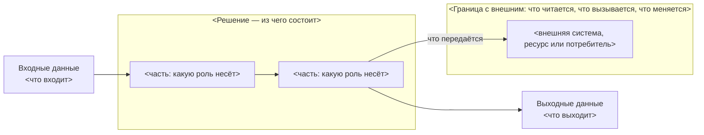

# PS-NNN: <название решения>

**Предмет:** продукт — уровень предмета: что описывается, поведение компонента.

Суть решения: <одна-две строки, что делает решение и зачем>. Статус `<Proposed|Accepted|Superseded>`;
источник — <проект>, [`<путь к файлу/каталогу>`](<относительная ссылка>), ревизия `<короткий хеш>`.
Известные копии: <другие реализации той же идеи в проекте-источнике — копии, варианты, стабы,
фейки: путь и отличие от основной; «нет» — только если поиск не нашёл>.

---

## Навигация

- [Задача](#задача)
- [Архитектура](#архитектура)
- [Бизнес-логика](#бизнес-логика)
- [Правила](#правила)
- [Приёмка](#приёмка)
- [Детали](#детали)
- [Версионирование](#версионирование)

---

## Задача

<Три вопроса, на которые отвечает раздел:
что за инструмент — проект-источник — и что он делает;
зачем ему эта способность и что из неё следует;
где способность в нём стоит — кто её вызывает и что от неё получает.
Затем границы пакета: что входит и что остаётся за границей.>

## Архитектура

Блоки берутся по роли в этом решении: что решает, что действует, что проверяет — если проверка
есть; что читается, что вызывается, что меняется, кто вызывает. Названия из образца пакета
(управление, исполнение, верификация) не обязательны: у клиента или библиотеки фазы проверки
и целевого окружения может не быть — тогда их блоков в схеме нет, а потребители показываются
как вызывающая сторона.

<Если схема описывает модель, а не порядок в коде — оговорка: какие фазы на схеме
не существуют в коде как отдельные этапы и где решения принимаются на самом деле.>

## Бизнес-логика

Порядок: <шаги работы одной строкой, через →>.

### <Группа решений>

| Ситуация | Решение |
|---|---|
| <ситуация> | <решение; подтверждено кодом или исполнением> |
| <ситуация с пометкой> | <решение> — в источнике не выполняется: <причина> |

## Правила

- <решение-принцип: коротко, без раскрытия, — и что он защищает>.
- <решение-принцип с причиной>.
- <ограничение: чего у решения нет — что оно сознательно не делает>.

## Приёмка

<Допущения окружения, без которых сценарии нельзя проверить: где лежит источник, что
установлено, какие переменные заданы.>

### <Группа сценариев>

#### Scenario: <имя>

- **WHEN** <условие>
- **THEN** <наблюдаемый результат>

## Детали

| Компонент | Где в коде |
|---|---|
| <компонент со схемы/таблиц> | <функции источника, таблицы, константы> |

<Границы, если заданы таблицами или константами источника. Детали не копируют тело функций
и файлы источника — только имена.>

---

## Версионирование

| Версия | Дата | Задача | Агент | Модель | Описание изменений |
|--------|------|--------|-------|--------|--------------------|
| 1.0.0 | <дата> | <задача, запрос или прогон> | <агент> | <модель> | Начальное создание: <что вошло в пакет> |
