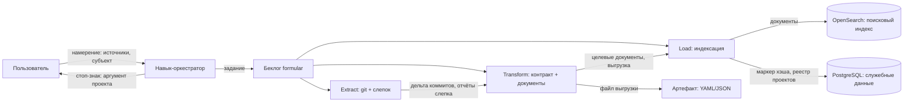

# Архитектура выгрузки проделанной работы из git-репозитория

Архитектурное решение состава, извлекающего проделанную работу из git-истории, агрегирующего её
по контракту `work-format.md` и загружающего в хранилище семантического поиска. Закрывает задачу
WRSP-021; реализация — отдельные задачи.

---

## Навигация

- [Понятия](#понятия)
- [Контекст и цели](#контекст-и-цели)
- [Состав и роли](#состав-и-роли)
- [Потоки данных](#потоки-данных)
- [Инкрементальность по хэшу git](#инкрементальность-по-хэшу-git)
- [Модель целевых документов индекса](#модель-целевых-документов-индекса)
- [Хранилище и выбор движка](#хранилище-и-выбор-движка)
- [Схема хранения](#схема-хранения)
- [Реестры](#реестры)
- [Приватность](#приватность)
- [Рассмотренные альтернативы](#рассмотренные-альтернативы)
- [Риски и ограничения](#риски-и-ограничения)
- [Версионирование](#версионирование)

---

## Понятия

| Понятие | Определение |
|---------|-------------|
| Проделанная работа (Implemented Work) | Совокупность коммитов лица или команды на линии истории со связью с кодом — по контракту `work-format.md` |
| ETL-конвейер (Extract–Transform–Load, ETL) | Конвейер из трёх ступеней: извлечение из источников, приведение к контракту, загрузка в хранилище |
| Слепок (Snapshot) | Каталог отчётов TLDR по способности `code-scan`; для быстрой ориентации и связи с кодом |
| Целевой документ (Index Document) | Единица хранения в индексе: коммит с путями, символами и фрагментами отчётов слепка |
| Реестр идентичностей (People Registry) | Файл вне git: `{slug, name, emails[], team}` каждого разработчика; коммитится шаблон `people.yaml` |
| Реестр проектов (Project Registry) | Таблица в PostgreSQL: `{slug, путь в рабочем пространстве}` каждого проекта |
| Инкрементальное состояние (Increment State) | Служебные данные хранилища: до какого хэша коммита обработан каждый источник |

Источником истины по терминологии выгрузки остаётся
[work-format.md](./work-format.md): понятия «пара», «область», «реестр идентичностей» здесь
потребляются, не переопределяются.

---

## Контекст и цели

Контракт выгрузки реализованной работы зафиксирован форматом `1.0` в
[work-format.md](./work-format.md): записи коммитов с типологией `code | integration`,
статус-лист путей с numstat, пара со слепком по нормализованному POSIX-пути. Контракт есть,
конвейера нет: выгрузка собирается вручную, инкрементальность и импорт в хранилище анализа
не автоматизированы.

Решение вводит состав из трёх частей:

1. **Навык-оркестратор** — принимает намерение пользователя, формирует задание, передаёт его
   formular; сам данные не обрабатывает.
2. **Шаблон беклога formular** — описывает ETL-конвейер операциями.
3. **Инструменты** — исполнимые ступени конвейера на Python.

Назначение хранилища — семантический поиск и анализ по проделанной работе: полнотекстовый поиск
BM25 с анализаторами текста (стемминг, синонимы, n-граммы, фразовый и размытый поиск) и
векторный поиск. Поисковый движок — OpenSearch; служебные данные — PostgreSQL (см.
«Хранилище и выбор движка»).

---

## Состав и роли

| Компонент | Роль | Обрабатывает данные |
|-----------|------|---------------------|
| Навык-оркестратор | Приём намерения, выборка проекта, формирование задания | Нет |
| Шаблон беклога formular | Декларация ETL-конвейера и порядка ступеней | Нет |
| Инструмент Extract | Чтение git-истории и съёмка/освежение слепка | Да |
| Инструмент Transform | Приведение к контракту и построение целевых документов | Да |
| Инструмент Load | Импорт целевых документов в хранилище | Да |

Навык начинается со **стоп-знака**: перед сбором он уточняет у пользователя, какой проект
смотрим, — аргумент проекта обязателен. Молчаливая подстановка проекта предыдущего прогона
запрещена: это и контракт намерения, и граница приватности — проект по умолчанию не утечёт
в артефакты.

Проекты живут внутри рабочего пространства без монтирования; пути к проектам выдаёт реестр
проектов по slug.

---

## Потоки данных

- **Extract** читает линию истории репозитория проекта и отчёты слепка; отдаёт дельту коммитов
  и материалы связи с кодом.
- **Transform** строит структуру контракта `work-format.md` и из неё — целевые документы;
  артефакт выгрузки (YAML/JSON) пишется той же структурой — формат конечный, под индекс,
  без промежуточной трансформации при загрузке.
- **Load** импортирует целевые документы в индекс OpenSearch, ведёт инкрементальное состояние
  в PostgreSQL и читает реестр проектов из PostgreSQL.

---

## Инкрементальность по хэшу git

Обе источниковые ступени инкрементальны и привязаны к хэшу коммита:

- **Извлечение из git**: хранилище хранит последний обработанный хэш линии; следующий прогон
  обрабатывает только дельту после него. Повторный прогон без новых коммитов — холостой.
- **Съёмка слепка**: слепок пересъёмка целиком только при смене хэша; при неизменном хэше
  используется существующий. Слепок остаётся срезом «как сейчас» — история им не заменяется.

Состояние живёт в PostgreSQL (см. «Схема хранения»), а не в локальных файлах конвейера:
оно переживает прогоны и смену машины. Пара «реляционное хранилище + поисковый индекс»
не даёт одной транзакции на обе системы, поэтому атомарность «документы + маркер хэша»
заменяется **компенсацией**: ступень Load индексирует документы в OpenSearch и только после
успешного ответа фиксирует маркер хэша в PostgreSQL; сбой между системами лечится повторным
прогоном, дубликаты исключает идемпотентная запись по естественному ключу документа.

> **Внимание:** частичный сбой между ступенями оставляет состояние на последнем успешном
> маркере; повторный прогон переобрабатывает дельту от него и перезаписывает документы
> идемпотентно — расхождения состояние и индекс не накапливают.

---

## Модель целевых документов индекса

Единица индекса — целевой документ коммита. Поля под BM25 и векторы:

| Группа полей | Содержимое | Назначение |
|--------------|------------|------------|
| Идентичность | sha, authored_at, author, author_email, kind, merged, task, branch | Фильтры и группировки |
| Тексты | subject, body, конкатенация заголовка и тела | BM25-индекс |
| Вектор | эмбеддинг текстов коммита | Семантический поиск |
| Пути | статус-лист затронутых путей области с numstat и парой со слепком | Связь с кодом, аналитика |
| Символы | имена классов и методов найденных путей | Связь с кодом, поиск по символу |
| Слепок | имя и дата съёмки слепка, фрагменты отчётов найденных путей | Контекст кода на момент индексации |

Требования к поиску, закрываемые анализаторами движка:

| Функция | Требование |
|---------|------------|
| BM25 | Алгоритм ранжирования — именно BM25 |
| Анализаторы текста | Конвейеры токенизации и нормализации текстовых полей |
| Стемминг | Snowball для русского и английского — обязательная функция |
| Лемматизация | Через плагины движка — опциональная, выбор не блокирует |
| Синонимы | Словарь синонимов анализатора; ведётся вручную, файл вне git |
| N-граммы | edge_ngram — префиксный поиск и автоподсказка; ngram — поиск по фрагментам идентификаторов кода (`Discount` находит `DiscountCalculator`) |
| Fuzzy matching | Размытый запрос по опечаткам, расстояние 1–2; «похожесть» описаний — функция векторов |
| Phrase matching | Фразовый запрос по текстовым полям документа |

Пара со слепком строится по нормализованному POSIX-пути и означает «путь присутствует
в слепке» — оговорка `snapshot_revision_unknown` контракта сохраняется. Поля `task`
и `branch` — плавающий источник истины: отсутствие — норма.

Сопоставление символов — по имени, не по номерам строк: строки дрейфуют между коммитом
и слепком.

---

## Хранилище и выбор движка

Выбрано **два движка с разделением ролей**: OpenSearch — поисковый индекс целевых документов,
PostgreSQL — служебные данные конвейера.

Обоснование:

- **Требования к поиску закрываются штатно**: BM25 — движок схожести по умолчанию OpenSearch;
  анализаторы текста, стемминг (Snowball, русский и английский), словари синонимов, n-граммы,
  фразовый и размытый поиск — штатные конвейеры и типы запросов. В PostgreSQL BM25 в чистом
  виде достижим только расширением ParadeDB pg_search, а лемматизация через плагины и словари
  синонимов уровня анализатора там беднее — кандидат «PostgreSQL + pg_search + pgvector»
  даёт тот же список функций через два расширения и Postgres-совместимую сборку ядра, без
  выигрыша в функциях.
- **Альтернатива «всё в одном PostgreSQL» отвергнута требованиями, не издержками**: список
  функций поиска (см. «Модель целевых документов индекса») — требование владельца, и он
  перевешивает прежний аргумент единого хранилища. Второй движок в инфраструктуре —
  осознанная цена.
- **Служебные данные остаются в PostgreSQL**: реестр проектов и инкрементальное состояние —
  реляционные структуры с транзакционностью; OpenSearch как индекс — состояние не ведёт.
- **Отдельная векторная БД не подключается**: k-NN поиск — штатная функция OpenSearch.
- **Объём данных** — история одного рабочего пространства, не веб-масштаб.

---

## Схема хранения

| Хранилище | Структура | Назначение |
|-----------|------------|------------|
| PostgreSQL | `projects` | Реестр проектов: slug, путь в рабочем пространстве |
| PostgreSQL | `ingest_state` | Инкрементальное состояние: проект, линия, последний обработанный хэш git |
| OpenSearch | индекс `commits` | Целевые документы: идентичность, тексты (BM25, анализаторы), вектор (k-NN), пути, символы, материалы слепка |
| OpenSearch | анализаторы индекса | Конвейеры: стемминг, синонимы, n-граммы; поле `search` — фразовый и размытый поиск |

Проект — граница индексов OpenSearch (индекс на проект) и первая грань фильтрации; фильтр
по проекту — первый предикат каждого запроса. Анализаторы и маппинг индекса — предмет задач
реализации; здесь зафиксированы структуры и их назначение. DDL служебных таблиц PostgreSQL
проверяется операцией forge.

---

## Реестры

- **Реестр идентичностей** — файл вне git по контракту [work-format.md](./work-format.md):
  `{slug, name, emails[], team}`; коммитится шаблон `people.yaml` с вымышленными записями.
  Выборка по person/team, точное совпадение email.
- **Реестр проектов** — таблица `projects` в PostgreSQL: `{slug, путь в рабочем пространстве}`.
  Аргумент проекта навыка — slug; по нему конвейер получает путь источника, а Load — имя
  индекса OpenSearch. Коммитится шаблон с вымышленными записями; реальный реестр наполняется
  при эксплуатации.

---

## Приватность

Границы данных состава:

- **При разработке** в публичный scope — задачу, беклог, коммитимые файлы, отчёты — реальные
  названия проектов, пользовательские данные и данные сканирования не попадают. Примеры
  в документах — вымышленные; пути в артефактах — плейсхолдеры (`raw/<repo>`,
  `reports/<project>`).
- **При эксплуатации** состав опирается на собственные данные: целевые документы содержат
  рабочие данные — код, коммиты, адреса авторов; это внутреннее хранилище рабочего
  пространства. Целевые документы и выгрузки наружу рабочего пространства не выходят.
- **Стоп-знак проекта** — обязательный аргумент: данные проекта не индексируются, пока
  пользователь явно не назвал проект.

> **Важно:** реальный реестр идентичностей — файл вне git; в репозиторий попадает только
> шаблон `people.yaml` с вымышленными записями. Реальные выгрузки в репозиторий не попадают.

---

## Рассмотренные альтернативы

| Вариант | Плюсы | Минусы | Почему не выбран |
|---|---|---|---|
| Чтение git-истории библиотекой-обёрткой против парсинга вывода git CLI | Обёртка: типизированные объекты, тестопригодность | Обёртка: зависимость и лаг поддержки форматов; CLI: полный контроль и отсутствие зависимостей | Решение на этапе реализации; контракт не навязывает способ чтения |
| Всё в одном PostgreSQL (ParadeDB pg_search + pgvector) | Один движок, транзакции «документы + маркер», служебные данные там же | BM25 — только через расширение; лемматизация и словари синонимов беднее; Postgres-совместимая сборка ядра ParadeDB | Список функций поиска — требование владельца; в OpenSearch он закрывается штатно, цена — второй сервис, осознанная |
| OpenSearch — поисковый индекс, PostgreSQL — служебные данные (выбрано) | BM25 и все функции анализаторов штатно; k-NN штатно; служебные данные транзакционны | Два движка: второй сервис в docker-compose; атомарность «документы + маркер» заменяется компенсацией | — |
| Один инструмент на три ступени против трёх отдельных | Один: меньше связности артефактов | Один: ступени нераздельно исполнимы; три: каждая исполнима и проверяема отдельно | Три отдельных: под-цели идемпотентны и вызываются по отдельности, шаблон formular ведёт их по порядку |

---

## Риски и ограничения

- **Два движка в инфраструктуре** — осознанная цена требований поиска: OpenSearch добавляет
  сервис в docker-compose (память, обслуживание); PostgreSQL для служебных данных всё равно
  нужен, разделение ролей делает каждый движок простым.
- **Компенсация вместо транзакции** между PostgreSQL и OpenSearch: сбой между системами
  лечится повторным прогоном с идемпотентной записью; расхождения состояние и индекс
  не накапливают, но окно между индексацией и фиксацией маркера существует.
- **Согласованность при частичных прогонах** закрывается компенсацией Load; сбой между
  ступенями оставляет состояние на последнем успешном маркере — повторный прогон
  переобрабатывает дельту.
- **Пара со слепком** не утверждает «код родился этим коммитом»: ревизия слепка
  не зафиксирована; потребитель обязан учитывать оговорку контракта.
- **Покрытие task/branch** — best effort: плавающий источник истины, отсутствие — норма.
- **Реализация не входит в решение**: маппинг и анализаторы индекса, DDL служебных таблиц,
  выбор обёртки git и модели эмбеддингов — предмет задач реализации, фиксируемых после
  утверждения решения.

---

## Версионирование

| Версия | Дата | Задача | Агент | Модель | Описание изменений |
|--------|------|--------|-------|--------|--------------------|
| 1.0.0 | 2026-11-11 | WRSP-021 | Claude Code | GLM 5.3 | Начальное создание: состав и роли (навык-оркестратор, шаблон беклога formular, ступени ETL), потоки данных, инкрементальность по хэшу git, модель целевых документов индекса, выбор PostgreSQL с обоснованием, схема хранения, реестры, границы приватности, альтернативы и риски |
| 1.1.0 | 2026-11-11 | WRSP-021 | Claude Code | GLM 5.3 | Движок перевыбран прожаркой технического решения: поисковый индекс — OpenSearch (BM25 штатно, анализаторы: стемминг, синонимы, n-граммы, фразовый и размытый поиск; k-NN для векторов), PostgreSQL — служебные данные (реестр проектов, инкрементальное состояние). Атомарность «документы + маркер хэша» заменена компенсацией с идемпотентной записью. В модель документов добавлена таблица требований к поиску; альтернатива «всё в одном PostgreSQL (pg_search + pgvector)» разобрана и отвергнута; риски и Mermaid-схема приведены к двухдвижковой архитектуре |
