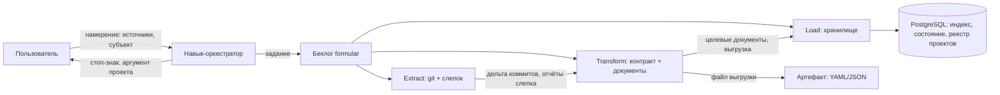

# Архитектура выгрузки проделанной работы из git-репозитория

Архитектурное решение состава, извлекающего проделанную работу из git-истории, агрегирующего её
по контракту `work-format.md` и загружающего в хранилище семантического поиска. Закрывает задачу
WRSP-021; реализация — отдельные задачи.

---

## Навигация

- [Понятия](#понятия)
- [Контекст и цели](#контекст-и-цели)
- [Состав и роли](#состав-и-роли)
- [Потоки данных](#потоки-данных)
- [Инкрементальность по хэшу git](#инкрементальность-по-хэшу-git)
- [Модель целевых документов индекса](#модель-целевых-документов-индекса)
- [Хранилище и выбор движка](#хранилище-и-выбор-движка)
- [Схема хранения PostgreSQL](#схема-хранения-postgresql)
- [Реестры](#реестры)
- [Приватность](#приватность)
- [Рассмотренные альтернативы](#рассмотренные-альтернативы)
- [Риски и ограничения](#риски-и-ограничения)
- [Версионирование](#версионирование)

---

## Понятия

| Понятие | Определение |
|---------|-------------|
| Проделанная работа (Implemented Work) | Совокупность коммитов лица или команды на линии истории со связью с кодом — по контракту `work-format.md` |
| ETL-конвейер (Extract–Transform–Load, ETL) | Конвейер из трёх ступеней: извлечение из источников, приведение к контракту, загрузка в хранилище |
| Слепок (Snapshot) | Каталог отчётов TLDR по способности `code-scan`; для быстрой ориентации и связи с кодом |
| Целевой документ (Index Document) | Единица хранения в индексе: коммит с путями, символами и фрагментами отчётов слепка |
| Реестр идентичностей (People Registry) | Файл вне git: `{slug, name, emails[], team}` каждого разработчика; коммитится шаблон `people.yaml` |
| Реестр проектов (Project Registry) | Таблица в PostgreSQL: `{slug, путь в рабочем пространстве}` каждого проекта |
| Инкрементальное состояние (Increment State) | Служебные данные хранилища: до какого хэша коммита обработан каждый источник |

Источником истины по терминологии выгрузки остаётся
[work-format.md](./work-format.md): понятия «пара», «область», «реестр идентичностей» здесь
потребляются, не переопределяются.

---

## Контекст и цели

Контракт выгрузки реализованной работы зафиксирован форматом `1.0` в
[work-format.md](./work-format.md): записи коммитов с типологией `code | integration`,
статус-лист путей с numstat, пара со слепком по нормализованному POSIX-пути. Контракт есть,
конвейера нет: выгрузка собирается вручную, инкрементальность и импорт в хранилище анализа
не автоматизированы.

Решение вводит состав из трёх частей:

1. **Навык-оркестратор** — принимает намерение пользователя, формирует задание, передаёт его
   formular; сам данные не обрабатывает.
2. **Шаблон беклога formular** — описывает ETL-конвейер операциями.
3. **Инструменты** — исполнимые ступени конвейера на Python.

Назначение хранилища — семантический поиск и анализ по проделанной работе: полнотекстовый поиск
(BM25) и векторный поиск в одном инструменте, без отдельной векторной БД.

---

## Состав и роли

| Компонент | Роль | Обрабатывает данные |
|-----------|------|---------------------|
| Навык-оркестратор | Приём намерения, выборка проекта, формирование задания | Нет |
| Шаблон беклога formular | Декларация ETL-конвейера и порядка ступеней | Нет |
| Инструмент Extract | Чтение git-истории и съёмка/освежение слепка | Да |
| Инструмент Transform | Приведение к контракту и построение целевых документов | Да |
| Инструмент Load | Импорт целевых документов в хранилище | Да |

Навык начинается со **стоп-знака**: перед сбором он уточняет у пользователя, какой проект
смотрим, — аргумент проекта обязателен. Молчаливая подстановка проекта предыдущего прогона
запрещена: это и контракт намерения, и граница приватности — проект по умолчанию не утечёт
в артефакты.

Проекты живут внутри рабочего пространства без монтирования; пути к проектам выдаёт реестр
проектов по slug.

---

## Потоки данных

- **Extract** читает линию истории репозитория проекта и отчёты слепка; отдаёт дельту коммитов
  и материалы связи с кодом.
- **Transform** строит структуру контракта `work-format.md` и из неё — целевые документы;
  артефакт выгрузки (YAML/JSON) пишется той же структурой — формат конечный, под индекс,
  без промежуточной трансформации при загрузке.
- **Load** импортирует документы, ведёт инкрементальное состояние и читает реестр проектов.

---

## Инкрементальность по хэшу git

Обе источниковые ступени инкрементальны и привязаны к хэшу коммита:

- **Извлечение из git**: хранилище хранит последний обработанный хэш линии; следующий прогон
  обрабатывает только дельту после него. Повторный прогон без новых коммитов — холостой.
- **Съёмка слепка**: слепок пересъёмка целиком только при смене хэша; при неизменном хэше
  используется существующий. Слепок остаётся срезом «как сейчас» — история им не заменяется.

Состояние живёт в хранилище (см. «Схема хранения»), а не в локальных файлах конвейера:
оно переживает прогоны и смену машины. Согласованность состояния с содержимым хранилища
обеспечивается транзакцией ступени Load: документы и маркер хэша фиксируются одним
подтверждением.

> **Внимание:** частичный сбой между ступенями оставляет состояние на последней успешной
> транзакции; повторный прогон переобрабатывает дельту от неё. Дубликаты исключаются
> идемпотентной записью по естественному ключу документа.

---

## Модель целевых документов индекса

Единица индекса — целевой документ коммита. Поля под BM25 и векторы:

| Группа полей | Содержимое | Назначение |
|--------------|------------|------------|
| Идентичность | sha, authored_at, author, author_email, kind, merged, task, branch | Фильтры и группировки |
| Тексты | subject, body, конкатенация заголовка и тела | BM25-индекс |
| Вектор | эмбеддинг текстов коммита | Семантический поиск |
| Пути | статус-лист затронутых путей области с numstat и парой со слепком | Связь с кодом, аналитика |
| Символы | имена классов и методов найденных путей | Связь с кодом, поиск по символу |
| Слепок | имя и дата съёмки слепка, фрагменты отчётов найденных путей | Контекст кода на момент индексации |

Пара со слепком строится по нормализованному POSIX-пути и означает «путь присутствует
в слепке» — оговорка `snapshot_revision_unknown` контракта сохраняется. Поля `task`
и `branch` — плавающий источник истины: отсутствие — норма.

Сопоставление символов — по имени, не по номерам строк: строки дрейфуют между коммитом
и слепком.

---

## Хранилище и выбор движка

Выбран **PostgreSQL**: полнотекстовый поиск и векторы в одном движке, реестр проектов
и инкрементальное состояние — там же.

Обоснование:

- **Один инструмент** — требование владельца: и BM25-подобный полнотекст, и векторы, и
  реляционная аналитика, и служебные данные в одном хранилище; отдельная векторная БД
  (Qdrant) не подключается.
- **Служебные данные уже спроектированы в PostgreSQL**: реестр проектов и инкрементальное
  состояние — реляционные структуры; второй движок пришлось бы держать ради одного индекса.
- **Транзакционность**: инкрементальность требует атомарности «документы + маркер хэша» —
  в PostgreSQL это нативно, в OpenSearch — обходными механизмами.
- **Объём данных** — история одного рабочего пространства, не веб-масштаб; оценка скорости
  pgvector на этом объёме достаточна (см. «Риски»).

В OpenSearch сильнее штатный BM25 и k-NN на больших объёмах, но он даёт второй сервис
в инфраструктуре, слабую транзакционность и раздельное хранение служебных данных —
преимущества на объёмах этого проекта не перевешивают издержки.

---

## Схема хранения PostgreSQL

| Структура | Назначение |
|-----------|------------|
| `projects` | Реестр проектов: slug, путь в рабочем пространстве |
| `commits` | Целевые документы: идентичность, тексты, пути, символы, материалы слепка |
| `commits.embedding` | Векторное поле под эмбеддинг (расширение pgvector) |
| `commits.search` | Полнотекстовый индекс (tsvector) под BM25-подобный поиск |
| `ingest_state` | Инкрементальное состояние: проект, линия, последний обработанный хэш git |

Проект — естественная граница партиционирования `commits`; фильтр по проекту — первый
предикат каждого запроса. Полнотекстовая морфология русского кода-комментариев выбирается
на этапе реализации по составу текстов; схема DDL — предмет задач реализации, здесь
зафиксированы структуры и их назначение.

---

## Реестры

- **Реестр идентичностей** — файл вне git по контракту [work-format.md](./work-format.md):
  `{slug, name, emails[], team}`; коммитится шаблон `people.yaml` с вымышленными записями.
  Выборка по person/team, точное совпадение email.
- **Реестр проектов** — таблица `projects` в PostgreSQL: `{slug, путь в рабочем пространстве}`.
  Аргумент проекта навыка — slug; по нему конвейер получает путь источника. Коммитится
  шаблон с вымышленными записями; реальный реестр наполняется при эксплуатации.

---

## Приватность

Границы данных состава:

- **При разработке** в публичный scope — задачу, беклог, коммитимые файлы, отчёты — реальные
  названия проектов, пользовательские данные и данные сканирования не попадают. Примеры
  в документах — вымышленные; пути в артефактах — плейсхолдеры (`raw/<repo>`,
  `reports/<project>`).
- **При эксплуатации** состав опирается на собственные данные: целевые документы содержат
  рабочие данные — код, коммиты, адреса авторов; это внутреннее хранилище рабочего
  пространства. Целевые документы и выгрузки наружу рабочего пространства не выходят.
- **Стоп-знак проекта** — обязательный аргумент: данные проекта не индексируются, пока
  пользователь явно не назвал проект.

> **Важно:** реальный реестр идентичностей — файл вне git; в репозиторий попадает только
> шаблон `people.yaml` с вымышленными записями. Реальные выгрузки в репозиторий не попадают.

---

## Рассмотренные альтернативы

| Вариант | Плюсы | Минусы | Почему не выбран |
|---|---|---|---|
| Чтение git-истории библиотекой-обёрткой против парсинга вывода git CLI | Обёртка: типизированные объекты, тестопригодность | Обёртка: зависимость и лаг поддержки форматов; CLI: полный контроль и отсутствие зависимостей | Решение на этапе реализации; контракт не навязывает способ чтения |
| PostgreSQL (full-text + pgvector) против OpenSearch (BM25 + k-NN) | PostgreSQL: один движок, транзакции, служебные данные там же | OpenSearch: сильнее BM25 и k-NN на больших объёмах | PostgreSQL — один инструмент для поиска, анализа и служебных данных; объёмы проекта не требуют OpenSearch |
| Один инструмент на три ступени против трёх отдельных | Один: меньше связности артефактов | Один: ступени нераздельно исполнимы; три: каждая исполнима и проверяема отдельно | Три отдельных: под-цели идемпотентны и вызываются по отдельности, шаблон formular ведёт их по порядку |

---

## Риски и ограничения

- **Скорость pgvector** на больших объёмах уступает специализированным движкам; при росте
  данных сверх ожидаемого — переоценка кандидата OpenSearch по таблице альтернатив.
- **Согласованность при частичных прогонах** закрывается транзакцией Load; сбой между
  ступенями оставляет состояние на последней успешной транзакции — повторный прогон
  переобрабатывает дельту.
- **Пара со слепком** не утверждает «код родился этим коммитом»: ревизия слепка
  не зафиксирована; потребитель обязан учитывать оговорку контракта.
- **Покрытие task/branch** — best effort: плавающий источник истины, отсутствие — норма.
- **Реализация не входит в решение**: DDL, морфология полнотекста, выбор обёртки git
  и модели эмбеддингов — предмет задач реализации, фиксируемых после утверждения решения.

---

## Версионирование

| Версия | Дата | Задача | Агент | Модель | Описание изменений |
|--------|------|--------|-------|--------|--------------------|
| 1.0.0 | 2026-11-11 | WRSP-021 | Claude Code | GLM 5.3 | Начальное создание: состав и роли (навык-оркестратор, шаблон беклога formular, ступени ETL), потоки данных, инкрементальность по хэшу git, модель целевых документов индекса, выбор PostgreSQL с обоснованием, схема хранения, реестры, границы приватности, альтернативы и риски |
