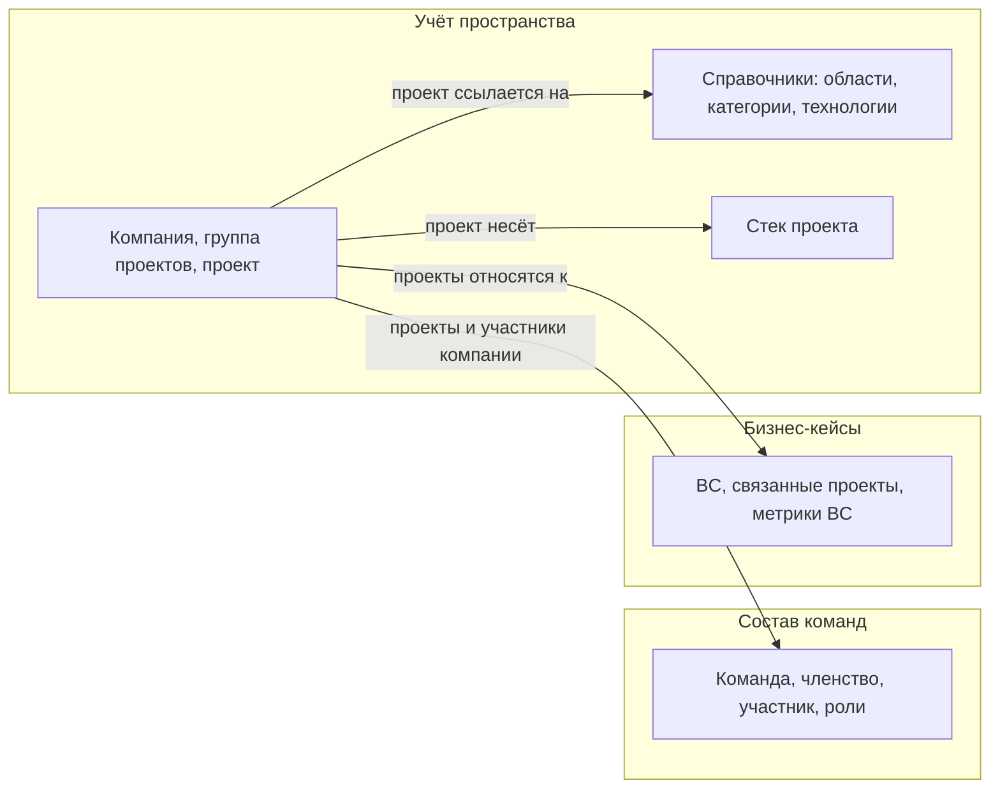
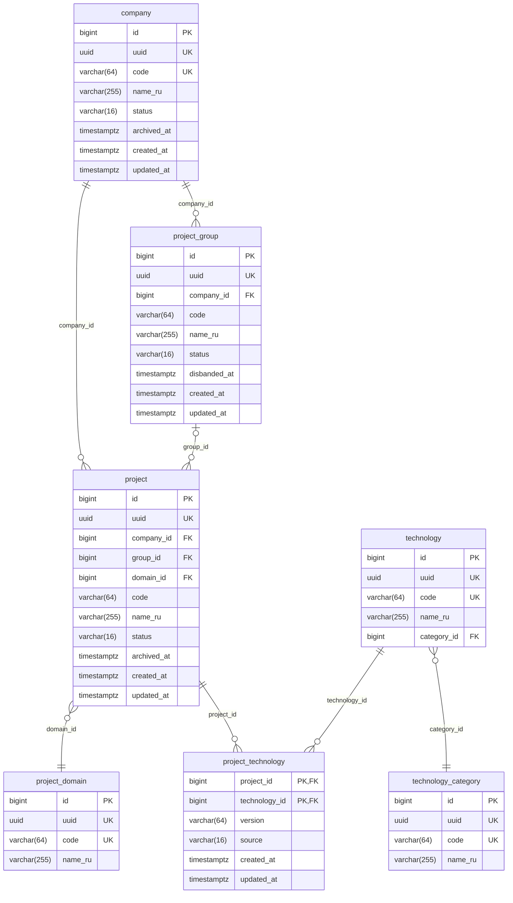
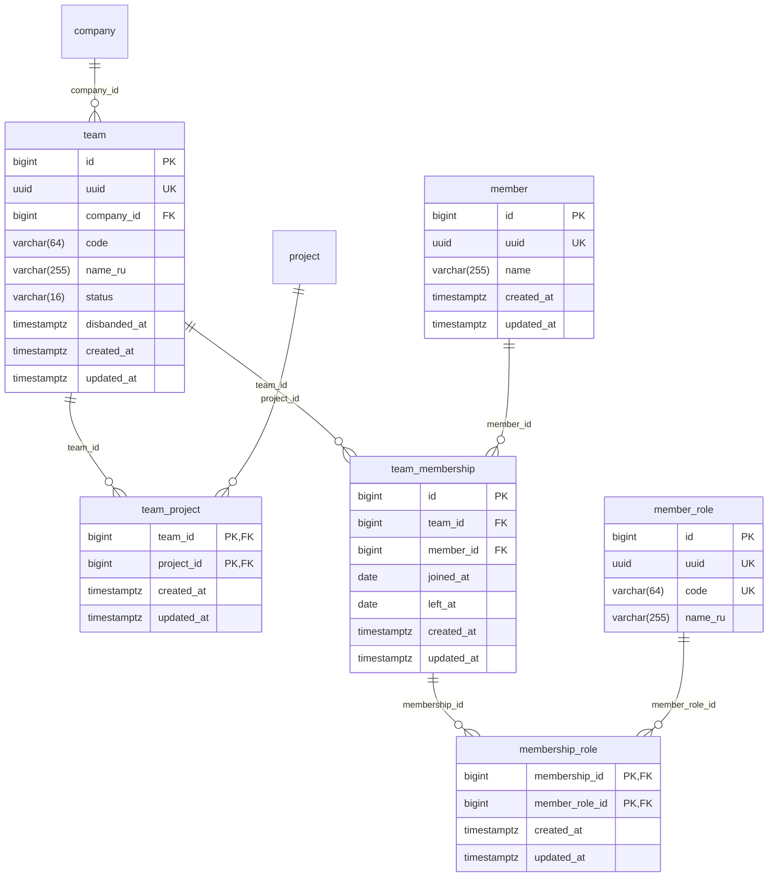
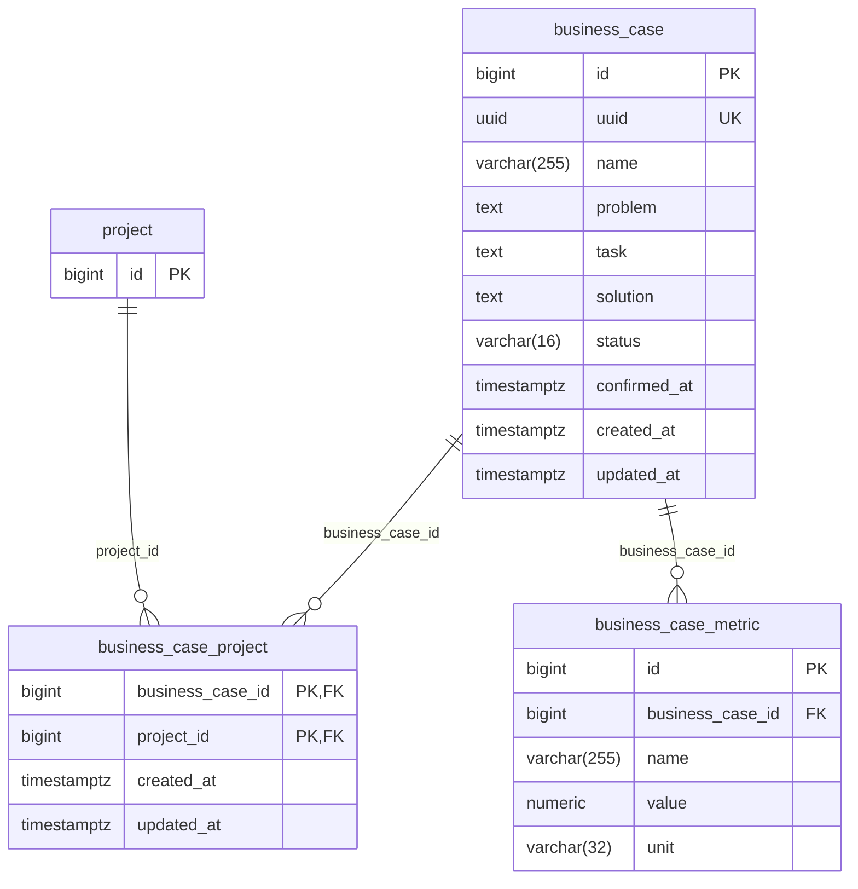

# Модель данных рабочего пространства

Реляционная модель данных системы управления рабочим пространством: таблицы PostgreSQL,
ключи, связи и отложенные области. Источник понятий — [требования](./requirements.md)
и [глоссарий](./glossary.md); модель требований не заменяет — «модель данных» выведена
из их границ отдельной работой.

---

## Навигация

- [Решения модели](#решения-модели)
- [Состав таблиц](#состав-таблиц)
- [Обзорная диаграмма](#обзорная-диаграмма)
- [Учёт пространства](#учёт-пространства)
- [Состав команд](#состав-команд)
- [Бизнес-кейсы](#бизнес-кейсы)
- [Ограничения и допущения](#ограничения-и-допущения)
- [Версионирование](#версионирование)

---

## Решения модели

Зафиксированные решения грумминга от 2026-10-30.

| Решение | Значение |
|---------|----------|
| СУБД | PostgreSQL; приёмка модели — через Liquibase Forge |
| Именование | Таблицы и колонки — английский snake_case по каноническим терминам глоссария ([DOC-002](../rules/documentation-rules.md#язык-и-терминология)); текст документа — русский |
| Ключи | Суррогатный `id` (bigint, identity) и неизменяемый `uuid` (`gen_random_uuid()`, уникальный) у каждой сущности; у справочников ещё `code` (машинный, уникальный) и `name_ru` |
| Идентификатор каталога | `code` компании — уникален глобально; `code` группы и проекта — уникален в пределах компании и служит именем каталога в раскладке |
| Открытые перечни | Справочные таблицы, а не enum и не check: перечень пополняет владелец без изменения схемы |
| Закрытые перечни | Статусы жизненного цикла — check-констрейнты: системный перечень, владельцем не расширяется |
| Аудит-колонки | `created_at` и `updated_at` у всех таблиц |
| Раскладка | Путь `<корень>/<компания>/<группа>/<проект>` вычисляется из `code`; в БД не хранится; архив выражается статусом проекта |
| Действующие лица | Владелец и LLM-агент в БД не хранятся: аутентификации нет, владелец один |

Целостность компании и группы: у `project_group` уникальность `(company_id, id)`, у проекта
составной FK `(company_id, group_id)` → `project_group (company_id, id)` — проект не может
ссылаться на группу другой компании; при `group_id IS NULL` проверка не применяется
(MATCH SIMPLE).

## Состав таблиц

| Таблица | Домен | Назначение |
|---------|-------|------------|
| `project_domain` | Учёт пространства | Справочник предметных областей проекта |
| `technology_category` | Учёт пространства | Справочник категорий технологий |
| `technology` | Учёт пространства | Справочник технологий с категорией |
| `company` | Учёт пространства | Компания пространства |
| `project_group` | Учёт пространства | Группа проектов одной компании |
| `project` | Учёт пространства | Проект — один git-репозиторий |
| `project_technology` | Учёт пространства | Стек проекта: технология, версия, источник |
| `member_role` | Состав команд | Справочник ролей участника |
| `team` | Состав команд | Команда одной компании |
| `team_project` | Состав команд | Связь команды с проектами |
| `member` | Состав команд | Участник — человек для анализа |
| `team_membership` | Состав команд | Членство участника в команде с периодом |
| `membership_role` | Состав команд | Роли участника в рамках членства |
| `business_case` | Бизнес-кейсы | BC: проблема, задача, решение, статус |
| `business_case_project` | Бизнес-кейсы | Связанные проекты BC |
| `business_case_metric` | Бизнес-кейсы | Метрики BC |

## Обзорная диаграмма

Иерархия: три домена; в учёт пространства входят справочники, учётные таблицы и стек.
Отложенные области (сбор данных, поиск) на диаграмме не рисуются — см. [допущения](#ограничения-и-допущения).

## Учёт пространства

Ограничения домена:

- статусы: `company.status` и `project.status` — `active` / `archived`; `project_group.status` —
  `active` / `disbanded`; дата в `archived_at` / `disbanded_at` обязательна при неактивном статусе;
- уникальность: `company.code` — глобально; `(company_id, code)` у `project` и `project_group`;
  `(company_id, id)` у `project_group` — для составного FK проекта;
- проект ссылается на предметную область `domain_id` обязательным FK — у проекта ровно одна
  область;
- `project_technology.source` — check `('manual')`; значение `collector` добавит грумминг сбора
  данных;
- `project_technology.version` — необязательная строка версии, например `8.3`, `7.1`, `16`.

## Состав команд

`company` и `project` показаны без атрибутов — они определены в диаграмме учёт пространства.

Ограничения домена:

- статус: `team.status` — `active` / `disbanded`; `disbanded_at` обязательна при расформировании;
  история команды после расформирования сохраняется для анализа;
- членство: `joined_at` и `left_at` необязательны; `left_at` не раньше `joined_at`;
- роли членства — из справочника `member_role`, несколько ролей на одно членство;
- у `team` уникальность `(company_id, code)`; команды каталогов не имеют, код — только машинный
  идентификатор;
- `member.name` — имя человека, как оно введено владельцем; русскости не предполагается,
  поэтому колонка названа `name`, а не `name_ru`.

## Бизнес-кейсы

`project` показан без атрибутов — он определён в диаграмме учёт пространства.

Ограничения домена:

- статус: `business_case.status` — `draft` / `confirmed`; `confirmed_at` обязательна
  при `confirmed`;
- название и тексты — `name`, `problem`, `task`, `solution`; метрика BC — имя, значение
  и необязательная единица измерения;
- подкрепление результата (связи на собранные данные git) в модель не входит — см. допущения.

## Ограничения и допущения

- **Отложено — сбор данных.** Домен целиком уходит на отдельный грумминг: намерение, охват,
  сбор, собранные данные, справочники `collector` и `data_kind`, настройка `project_collector`
  и `excluded_path`. Решение владельца от 2026-10-30: в домене много нюансов, модель приёмет
  после него.
- **Отложено — гибридный поиск.** Поисковый индекс — внешнее хранилище; в реляционной модели
  таблиц поиска нет.
- **Отложено — агрегация и анализ.** Сводки, отчёты, горячие точки, тренды и сравнения
  вычисляются поверх собранных данных; таблиц не создают.
- **Отложено — подкрепление BC.** Связи `evidence_commit` на коммиты появятся после грумминга
  сбора — цель для FK возникнет вместе с собранными данными. Статус `confirmed` без связей
  на коммиты допустим.
- **Допущение — стек.** Колонка `project_technology.source` зарезервирована: пока допустимо
  только `manual`; после грумминга сбора сборщик будет помечать технологии значением `collector`,
  а порядок совмещения ручных и автоматических значений прорабатывается там же.
- **Допущение — сопоставление авторов.** Авторы git-данных и их связь с `member` появятся
  в модели после грумминга сбора.
- **Допущение — коды проектов и групп.** Уникальность кодов между таблицами `project`
  и `project_group` в пределах компании («идентификатор группы уникален вместе
  с идентификаторами проектов») стандартным ограничением на две таблицы не задаётся — её
  контролирует приложение.
- **Допущение — повторное членство.** Возвращение участника в команду создаёт новую строку
  `team_membership`; пересечение открытых периодов одного участника в одной команде
  контролирует приложение.
- **Допущение — приёмка.** Документ описывает целевую модель; изменения схемы принимает
  Liquibase Forge операцией модели, changelog он дописывает в принятый корень `db/changelog/`.

## Версионирование

| Версия | Дата | Задача | Агент | Модель | Описание изменений |
|--------|------|--------|-------|--------|--------------------|
| 1.0.0 | 2026-10-30 | Запрос пользователя: разработать модель данных по требованиям и глоссарию (грумминг-опрос) | Claude Code | glm-5.3-flash | Начальное создание: решения модели, состав из 16 таблиц трёх доменов — учёт пространства, состав команд, бизнес-кейсы, — обзорная и три доменные диаграммы Mermaid erDiagram, ограничения доменов. Сбор данных, поиск, агрегация с анализом и подкрепление BC отложены в допущения до отдельного грумминга |
