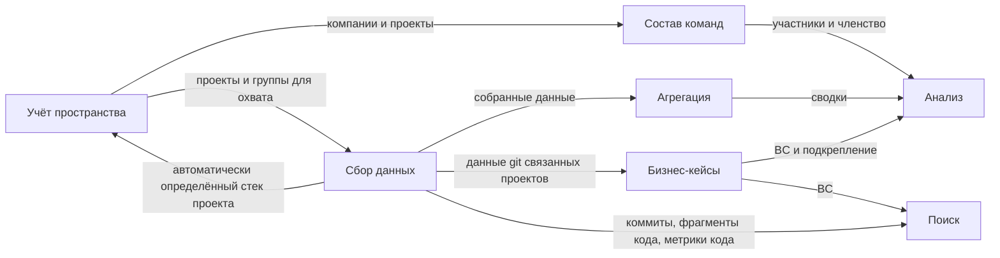

# Глоссарий проекта

Единый язык (Ubiquitous Language) системы управления рабочим пространством: домены системы
и канонические термины каждого из них. Термины, перечисленные в колонке «Избегать», для понятия
не используются — ни в документах, ни в коде, ни в разговоре.

---

## Навигация

- [Домены](#домены)
- [Учёт пространства](#учёт-пространства)
- [Состав команд](#состав-команд)
- [Сбор данных](#сбор-данных)
- [Агрегация](#агрегация)
- [Бизнес-кейсы](#бизнес-кейсы)
- [Анализ](#анализ)
- [Поиск](#поиск)
- [Ограничения и допущения](#ограничения-и-допущения)
- [Версионирование](#версионирование)

---

## Домены

Система делится на семь доменов. Домен отвечает на один вопрос о пространстве и владеет своими
терминами; соседние домены этими терминами пользуются, но не переопределяют их.

| Домен | Вопрос, на который отвечает | Ключевые термины |
|-------|-----------------------------|------------------|
| Учёт пространства (Workspace Registry) | Что входит в пространство, кому принадлежит и где лежит на диске | Рабочее пространство, компания, проект, стек проекта, технология, группа проектов, раскладка |
| Состав команд (Team Composition) | Кто работал над проектами и в каком качестве | Команда, участник, членство в команде, роль участника |
| Сбор данных (Data Collection) | Какие данные о проектах получены и откуда | Намерение, охват, сбор, сборщик, автор |
| Агрегация (Aggregation) | Как собранные данные выглядят в сумме | Сводка, уровень агрегации |
| Бизнес-кейсы (Business Cases) | Какие бизнес-решения приняты и чем подкреплён их результат | BC, подкрепление, подтверждение результата |
| Анализ (Analysis) | Что собранные данные говорят о проектах, BC и людях | Отчёт, горячая точка, тренд, вклад |
| Поиск (Search) | Где в данных пространства нужное | Гибридный поиск, объект поиска |

---

## Учёт пространства

| Термин | Определение | Избегать |
|--------|-------------|----------|
| Рабочее пространство (Workspace) | Совокупность компаний, проектов, команд, BC и собранных о них данных, которую ведёт один владелец | воркспейс, система, окружение |
| Владелец пространства (Workspace Owner) | Единственный человек, который ведёт рабочее пространство и выполняет все операции системы | пользователь, администратор, разработчик |
| LLM-агент (LLM Agent) | Ассистент владельца, выполняющий операции системы от его имени; результат BC не подтверждает | бот, ИИ |
| Компания (Company) | Организация, которой принадлежат проекты и команды | организация, клиент, заказчик |
| Проект (Project) | Один git-репозиторий, учтённый в пространстве и принадлежащий ровно одной компании | репозиторий, репо, сервис, приложение |
| Стек проекта (Project Stack) | Набор технологий проекта: определяется сборщиком автоматически, владелец дополняет и исправляет его вручную | техстек, технологический стек, окружение |
| Технология (Technology) | Элемент стека проекта: имя, категория технологии и необязательная версия, например `php` 8.3, `symfony` 7.1, `postgresql` 16 | инструмент, зависимость, пакет |
| Категория технологии (Technology Category) | Вид технологии из открытого перечня: язык, фреймворк, платформа, хранилище данных и другие | тип технологии, класс |
| Группа проектов (Project Group) | Именованный набор проектов одной компании для агрегации, анализа и поиска; проект входит не больше чем в одну группу, вложенных групп нет; на диске — каталог группы | портфель, кластер, коллекция |
| Расформирование группы (Group Disbandment) | Вывод группы проектов из компании: её проекты переносятся на уровень компании, каталог группы удаляется | удаление группы, снятие с учёта |
| Снятие с учёта (Deregistration) | Вывод компании или проекта из рабочего пространства; каталог проекта переносится в архив | удаление, исключение, архивация |
| Корень пространства (Workspace Root) | Каталог на диске, в котором лежит раскладка рабочего пространства | рабочая папка, домашний каталог |
| Раскладка (Layout) | Расположение проектов на диске, повторяющее структуру пространства: `<корень>/<компания>/<группа>/<проект>` для проекта в группе и `<корень>/<компания>/<проект>` без группы; имя каталога — идентификатор компании, группы или проекта | структура папок, дерево каталогов, layout |
| Каталог группы (Group Directory) | Каталог `<корень>/<компания>/<группа>/`, в котором лежат проекты группы проектов | папка группы, подкаталог компании |
| Архив (Archive) | Каталог `_archive/<компания>/<проект>` для проектов, снятых с учёта; репозиторий в нём сохраняется | корзина, удалённые проекты |
| Расхождение раскладки (Layout Drift) | Несоответствие диска учёту: каталог без учтённого проекта или учтённый проект без каталога | рассинхрон, дрифт, мусор |

---

## Состав команд

| Термин | Определение | Избегать |
|--------|-------------|----------|
| Команда (Team) | Состав участников одной компании, работающий над одним или несколькими её проектами | группа, отдел, подразделение |
| Участник (Member) | Человек, учтённый в пространстве как объект анализа; операций в системе не выполняет; учитывается один раз, сколько бы команд ни сменил | пользователь, сотрудник, разработчик, автор |
| Членство в команде (Team Membership) | Участие участника в одной команде: его роли и период между необязательными датами входа и выхода | назначение, позиция, привязка |
| Роль участника (Member Role) | Роль участника в рамках членства из открытого перечня — `dev`, `qa`, тимлид, архитектор и другие; прав доступа не задаёт | должность, право, permission |
| Расформирование команды (Team Disbandment) | Вывод команды из текущего состава компании с сохранением её истории для анализа | удаление команды, снятие с учёта |

---

## Сбор данных

| Термин | Определение | Избегать |
|--------|-------------|----------|
| Намерение (Intent) | Заявленная владельцем цель сбора: охват и виды данных | запрос, задание, job |
| Охват (Scope) | Часть намерения, называющая проекты — перечнем, группой проектов или компанией — и виды данных | выборка, фильтр |
| Сбор (Collection) | Однократное исполнение намерения, фиксирующее данные проектов на свой момент | синхронизация, импорт, скан, индексация |
| Сборщик (Collector) | Подключаемый источник данных о проекте: git, AST, метрики кода, стек проекта и другие | коллектор, плагин, парсер, интеграция |
| Вид данных (Data Kind) | Категория собранных данных, которую поставляет сборщик | тип данных, формат |
| Собранные данные (Collected Data) | Данные о проектах, полученные сборщиками в ходе сборов | сырые данные, датасет |
| Исключённый путь (Excluded Path) | Путь внутри проекта, который сборщики не обрабатывают | исключение, игнор, необрабатываемый путь |
| Автор (Author) | Человек, как он записан в git-данных проекта; участником не является, пока с ним не сопоставлен | участник, коммиттер, разработчик |
| Метрика кода (Code Metric) | Количественная характеристика кода проекта, полученная сборщиком | метрика без уточнения, KPI |

---

## Агрегация

| Термин | Определение | Избегать |
|--------|-------------|----------|
| Сводка (Summary) | Собранные данные, сведённые на одном уровне агрегации, в том числе во времени | агрегат, отчёт, дашборд |
| Уровень агрегации (Aggregation Level) | Объект, по которому сводятся данные: проект, группа проектов, компания или рабочее пространство | срез, ось, разрез |

> **Примечание:** слово «агрегат» под запретом намеренно: в [правилах DDD](../rules/ddd.md#агрегат-ddd-006009)
> оно обозначает единицу транзакционной согласованности.

---

## Бизнес-кейсы

| Термин | Определение | Избегать |
|--------|-------------|----------|
| Бизнес-кейс (Business Case, BC) | Проблема, задача и бизнес-решение вместе: проблема BC, задача BC, решение BC и, при наличии, метрики BC; относится к одному или нескольким проектам. BC включает задачу, но задачей не является | кейс, задача, тикет, фича, инициатива |
| Проблема BC (BC Problem) | Бизнес-проблема, ради которой заведён BC | боль, запрос |
| Задача BC (BC Task) | Что нужно сделать, чтобы снять проблему BC | тикет, таск, требование |
| Решение BC (BC Solution) | Принятый способ выполнить задачу BC и снять проблему BC | реализация, фикс |
| Метрика BC (Business Metric) | Измеримый бизнес-показатель, по которому оценивается результат BC | KPI, метрика без уточнения |
| Связанный проект (Linked Project) | Проект, к которому относится BC | затронутый проект, проект BC |
| Результат BC (BC Outcome) | Изменение, которого достиг BC | эффект, итог |
| Подкрепление (Evidence) | Данные git связанных проектов, на которые опирается результат BC | доказательство, привязка коммитов |
| Подтверждение результата (Outcome Confirmation) | Принятие владельцем результата BC на основании подкрепления; выполняет только владелец | согласование, апрув, закрытие BC |

> **Внимание:** «Кейс (Case)» без уточнения занят [правилами документов проекта](../rules/project-docs-rules.md#понятия)
> в другом смысле, поэтому бизнес-кейс всегда называется BC.

---

## Анализ

| Термин | Определение | Избегать |
|--------|-------------|----------|
| Отчёт (Report) | Результат анализа собранных данных по проектам, BC или участию | сводка, дашборд, аналитика |
| Сводный отчёт по проекту (Project Summary Report) | Отчёт о ключевых метриках кода проекта и их изменении | карточка проекта, профиль |
| Горячая точка (Hotspot) | Файл или модуль проекта, где одновременно высоки объём изменений и сложность | проблемное место, техдолг |
| Тренд (Trend) | Изменение метрик кода между сборами | динамика, история |
| Граф зависимостей (Dependency Graph) | Связи модулей проекта по данным AST | карта модулей, схема |
| Сравнение проектов (Project Comparison) | Сопоставление метрик кода проектов одной группы проектов или компании | бенчмарк, рейтинг |
| Отчёт по BC (BC Report) | Отчёт о том, что изменено в связанных проектах в подкрепление BC: файлы, модули, объём изменений | отчёт по кейсу |
| Отчёт по участию (Participation Report) | Отчёт о том, кто что делал и из кого состояли команды за период | отчёт по команде, табель |
| Вклад (Contribution) | Изменения в проектах, приписанные участнику через сопоставление с авторами | активность, производительность |

---

## Поиск

| Термин | Определение | Избегать |
|--------|-------------|----------|
| Гибридный поиск (Hybrid Search) | Поиск по данным проектов и BC с единым ранжированием по лексическому и семантическому совпадению | полнотекстовый поиск, векторный поиск, RAG |
| Объект поиска (Search Object) | Единица выдачи гибридного поиска: фрагмент кода, коммит, метрика кода или BC | документ, результат, хит |
| Фильтр поиска (Search Filter) | Ограничение выдачи по компании, проекту, группе проектов, типу объекта поиска или периоду | фасет, условие |

---

## Ограничения и допущения

- **Допущение:** источник понятий — [первичные требования](./requirements.md) версии 1.0.4;
  определения требований сохранены по смыслу и сжаты.
- **Допущение:** домены выделены как предметные области одной модели: ни один термин не меняет
  смысла между доменами. Делить их на отдельные ограниченные контексты — архитектурное решение,
  которое здесь не принимается.
- **Ограничение:** термины «Снятие с учёта», «Сбор» в значении однократного исполнения, «Исключённый
  путь», «Автор», «Метрика кода», «Метрика BC», «Сводка», «Подкрепление», «Подтверждение результата»
  и «Вклад» введены глоссарием поверх требований; [требования](./requirements.md) пользуются ими
  без переопределения, а их правка синхронизируется в обоих документах по
  [TERM-009](../rules/terminology.md#согласованность).

---

## Версионирование

| Версия | Дата | Задача | Агент | Модель | Описание изменений |
|--------|------|--------|-------|--------|--------------------|
| 1.0.0 | 2026-10-28 | Запрос пользователя: составить единый язык и домены проекта по первичным требованиям | Claude Code | Claude Opus 5.5 | Начальное создание: семь доменов с картой связей, канонические термины каждого домена с запрещёнными синонимами |
| 1.0.1 | 2026-10-28 | Запрос пользователя: дополнить глоссарий по обновлённым требованиям | Claude Code | Claude Opus 5.5 | По требованиям версии 1.0.2 в домен «Учёт пространства» добавлены термины «Стек проекта», «Технология» и «Категория технологии»; в определение сборщика добавлен стек проекта как источник; на карту доменов добавлена связь «Сбор данных → Учёт пространства» с автоматически определённым стеком проекта; ссылка на источник понятий переведена на версию требований 1.0.2 |
| 1.0.2 | 2026-10-28 | Запрос пользователя: согласовать требования с глоссарием | Claude Code | Claude Opus 5.5 | Требования версии 1.0.3 переведены на термины глоссария; ссылка на источник понятий переведена на эту версию, ограничение о терминах, введённых поверх требований, переформулировано: расхождения формулировок устранены, требования пользуются терминами без переопределения. В домене «Бизнес-кейсы» уточнено определение BC — проблема, задача и решение вместе, — добавлен термин «Задача BC», определения «Проблема BC» и «Решение BC» согласованы с ним. Домены не изменились |
| 1.0.3 | 2026-10-28 | Запрос пользователя: хранить проекты в физической структуре каталогов, соответствующей структуре пространства | Claude Code | Claude Opus 5.5 | По требованиям версии 1.0.4 в домен «Учёт пространства» добавлены термины «Корень пространства», «Раскладка», «Каталог группы», «Архив», «Расхождение раскладки», «Расформирование группы»; определение «Группы проектов» сужено до набора проектов одной компании, в который проект входит не больше одного раза; вопрос домена расширен до «где лежит на диске»; в определение «Снятия с учёта» добавлен перенос каталога в архив; ссылка на источник понятий переведена на версию требований 1.0.4 |
