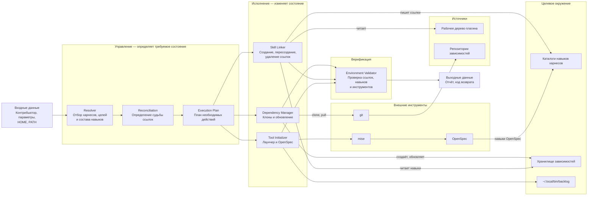

# PS-001: Подключение навыков плагина к харнесам агентов

**Предмет:** продукт — уровень предмета: что описывается, поведение компонента.

Суть решения: одной командой связать навыки плагина и его зависимостей с каталогами навыков
агентов-харнесов. Статус `Accepted`; источник — tessera,
[`scripts/setup.sh`](../../projects/software-engineering/ai-agent-engineering/tessera/scripts/setup.sh),
ревизия `753fdff`. Известная копия — `scripts/install.sh` того же репозитория.

---

## Навигация

- [Задача](#задача)
- [Архитектура](#архитектура)
- [Бизнес-логика](#бизнес-логика)
- [Правила](#правила)
- [Приёмка](#приёмка)
- [Детали](#детали)
- [Версионирование](#версионирование)

---

## Задача

Контрибьютор плагина держит несколько агентов-харнесов и хочет, чтобы каждый видел навыки плагина
прямо из рабочего дерева, а правки действовали сразу. Одиночная ссылка не подходит: она не знает,
где у какого харнеса каталог навыков, может затереть чужое и не переживает повторный запуск.

## Архитектура

Схема описывает устройство решения, а не порядок в коде. В исходнике согласование и план — не
отдельные фазы: судьба ссылки решается в момент связывания, после получения зависимостей, поэтому
состав навыков известен только после клонирования. `--uninstall` идёт коротким путём: отбор целей,
судьба своих ссылок, снятие.

## Бизнес-логика

Порядок: параметры → харнесы и цели → зависимости → навыки → ссылки → лаунчер и OpenSpec →
самопроверка и отчёт.

### Решения запуска

| Ситуация | Решение |
|---|---|
| Харнес найден: признак в домашнем каталоге или команда в `PATH` | Его каталог навыков — цель. `project` берёт каталог репозитория, `user` — каталог харнеса; общий каталог — одна цель |
| Харнес из `--harness` не найден | Пропускает с сообщением, работает дальше |
| Целей нет | Отказ, код 1, подсказка про `--skills-dir` |
| `--plugin-only` | Только навыки плагина: без хранилища, лаунчера и OpenSpec |
| Клон зависимости отсутствует, чистый, с правками | Клонирует `main`, обновляет fast-forward, не трогает и сообщает |
| formular в составе; лаунчер отсутствует, свой, чужой | Создаёт, перезаписывает, сохраняет копией и создаёт |
| OpenSpec | `openspec init` с именами отобранных харнесов; `user` передаётся как `global`; `openspec/config.yaml` сохраняется и возвращается |
| Самопроверка | Все ссылки разрешаются в `SKILL.md`, лаунчер отвечает; иначе отчёт и код 1 |

### Запись в каталоге навыков

| Запись | Действие |
|---|---|
| Нет записи | Создать ссылку |
| Ссылка, цель которой в хранилище или в рабочем дереве плагина | Пересоздать |
| Такая же ссылка, но цель исчезла | Снять. В источнике не работает: `canonical` не следует висячей ссылке |
| Ссылка куда-то ещё | Не трогать, назвать в отчёте |
| Файл или каталог | Не трогать, назвать в отчёте |

### Снятие `--uninstall`

| Ссылка | `project` | `user` |
|---|---|---|
| На навык плагина | Снимается | Снимается |
| На навык зависимости | Снимается; с `--plugin-only` остаётся | Остаётся, с пометкой в отчёте |

Хранилище и лаунчер не трогаются.

## Правила

- Чужое не трогается.
- Навыки связываются, а не копируются: правка сразу видна харнесу.
- Повторный запуск даёт то же состояние, без диалога.
- Успех доказан самопроверкой; провал — код 1.

## Приёмка

Сценарии даны для клона репозитория плагина, где `plugins/tessera-plugin/skills` содержит хотя
бы один навык. «Цель» — каталог навыков, «хранилище» — `~/.local/share/tessera/`. Проверяются во
временном `HOME`, без команд харнесов в `PATH` и в локали `C`.

### Основной путь

#### Scenario: Первый запуск в проектной области

- **WHEN** хранилище пусто, найдены харнесы zcode и claude, запуск идёт без параметров
- **THEN** formular и mattpocock-skills склонированы в хранилище на ветке main; в `<клон>/.agents/skills` и `<клон>/.claude/skills` есть ссылки на каждый навык плагина (источник — рабочее дерево) и каждой зависимости (источник — хранилище); пользовательские каталоги навыков не тронуты; лаунчер `~/.local/bin/backlog` создан; отчёт по каждой цели сообщает «проверка пройдена»; код 0

#### Scenario: Повторный запуск идемпотентен

- **WHEN** настройка уже выполнена, запуск повторяется без параметров
- **THEN** новых записей в целях нет; свои ссылки пересозданы; каждый клон «актуален» или «обновлён»; код 0

#### Scenario: Общий каталог обрабатывается один раз

- **WHEN** найдены zcode, codex и gemini, запуск идёт с `--scope user`
- **THEN** `~/.agents/skills` обработан один раз, в нём по одной ссылке на навык; в отчёте каталог назван один раз

#### Scenario: Харнес без команды в PATH

- **WHEN** есть `~/.zcode`, команды `zcode` в `PATH` нет, запуск идёт без параметров
- **THEN** харнес отобран по признаку, его каталог навыков связан

#### Scenario: Только плагин

- **WHEN** запуск идёт с `--plugin-only`
- **THEN** связаны только навыки плагина из рабочего дерева; хранилище не тронуто; лаунчер не установлен; OpenSpec — «пропущено (--plugin-only)»; код 0

#### Scenario: Лаунчер отсутствует

- **WHEN** formular в составе запуска, файла `~/.local/bin/backlog` нет
- **THEN** создана обёртка, `backlog --help` возвращает 0

#### Scenario: Лаунчер чужой

- **WHEN** formular в составе запуска, по пути лаунчера лежит чужой файл
- **THEN** он сохранён как `backlog.bak`, при занятом имени — `backlog.bak.1` и далее; путь назван в отчёте

#### Scenario: Лаунчер свой

- **WHEN** formular в составе запуска, по пути лаунчера лежит своя обёртка
- **THEN** она перезаписана, резервной копии нет

#### Scenario: Конфигурация OpenSpec сохраняется

- **WHEN** в репозитории есть `openspec/config.yaml`, регистрация навыков OpenSpec выполнена
- **THEN** содержимое файла то же; отчёт — «зарегистрированы: <харнесы> (область <область>)»

#### Scenario: Область user передаётся в OpenSpec как global

- **WHEN** запуск идёт с `--scope user`, `openspec` доступен
- **THEN** `openspec init` вызван с `--scope global`

#### Scenario: Нет ни mise, ни openspec

- **WHEN** `--plugin-only` не задан, ни `mise`, ни `openspec` не найдены
- **THEN** предупреждение, в отчёте «пропущено: нет mise и openspec», код 0

#### Scenario: Чужой элемент в цели

- **WHEN** в цели лежат чужая ссылка или каталог с именем навыка
- **THEN** они не тронуты и перечислены в отчёте среди пропущенных чужих элементов

#### Scenario: Устаревшая ссылка

- **WHEN** в цели лежит своя ссылка на навык, которого больше нет в источнике
- **THEN** ссылка снята и названа в отчёте

> **Внимание:** в источнике сценарий не выполняется: `canonical` не следует висячей ссылке.

#### Scenario: Снятие в проектной области

- **WHEN** настройка выполнена в `project`, запуск идёт с `--uninstall`
- **THEN** сняты ссылки плагина и зависимостей в целях репозитория; хранилище и лаунчер не тронуты; отчёт называет число снятых ссылок; код 0

#### Scenario: Снятие в пользовательской области

- **WHEN** настройка выполнена в `user`, запуск идёт с `--scope user --uninstall`
- **THEN** ссылки плагина сняты; ссылки зависимостей оставлены с пометкой «ссылка зависимости поставки, оставлена»

#### Scenario: Снятие только ссылок плагина

- **WHEN** настройка выполнена в `project`, запуск идёт с `--uninstall --plugin-only`
- **THEN** сняты только ссылки плагина

#### Scenario: Сужение по харнесам

- **WHEN** запуск идёт с `--harness claude`
- **THEN** связан только claude, остальные цели не тронуты

#### Scenario: Харнес из --harness не найден

- **WHEN** запуск идёт с `--harness codex --skills-dir extra-skills`, а codex не найден
- **THEN** сообщение «Харнес codex не найден — пропущен.», каталог из `--skills-dir` связан, код 0

#### Scenario: Дополнительный каталог навыков задан относительным путём

- **WHEN** запуск идёт с `--skills-dir tmp-skills`
- **THEN** путь считается от корня репозитория, каталог создан и связан

#### Scenario: Дополнительный каталог навыков задан абсолютным путём

- **WHEN** запуск идёт с `--skills-dir /tmp/skills`
- **THEN** путь взят как есть, каталог создан и связан

#### Scenario: Запуск из другого каталога

- **WHEN** скрипт вызван абсолютным путём из другого каталога
- **THEN** корень репозитория определён по расположению скрипта, настройка выполнена

### Ошибки и границы

#### Scenario: Неизвестный параметр или аргумент

- **WHEN** запуск идёт с `--force` или с позиционным аргументом
- **THEN** код 2; сообщение об ошибке и справка — в stderr

#### Scenario: Ошибка в значении параметра

- **WHEN** запуск идёт с `--scope` последним аргументом, с `--scope=`, с `--scope global` или с `--harness emacs`
- **THEN** код 2 с сообщением о причине

#### Scenario: HOME не задана

- **WHEN** `HOME` не задана или не абсолютна
- **THEN** код 1

#### Scenario: Запуск не из клона

- **WHEN** запуск идёт из каталога без `plugins/tessera-plugin/skills`
- **THEN** код 1 с подсказкой запускать из клона tessera

#### Scenario: Нет ни одной цели

- **WHEN** харнесы не найдены, `--skills-dir` не задан
- **THEN** код 1 с подсказкой передать `--skills-dir`

#### Scenario: Источник не получен

- **WHEN** хранилище пусто, источник зависимости недоступен
- **THEN** код 1; в сообщении последняя строка вывода git; ссылки не созданы

#### Scenario: Клон с локальными изменениями

- **WHEN** клон компонента в хранилище содержит локальные изменения
- **THEN** клон не обновлён, запуск продолжается, в отчёте «не обновлён: есть локальные изменения», код 0

#### Scenario: В хранилище лежит не клон

- **WHEN** в хранилище лежит каталог компонента без `.git`
- **THEN** код 1 с указанием удалить каталог вручную

#### Scenario: В клоне нет каталога навыков

- **WHEN** в клоне компонента нет каталога навыков из его строки таблицы
- **THEN** код 1

#### Scenario: Имя навыка повторяется

- **WHEN** имя навыка есть и в плагине, и в зависимости
- **THEN** код 1 с сообщением о повторе имени

#### Scenario: Ссылку создать не удалось

- **WHEN** существующий каталог-цель недоступен для записи
- **THEN** код 1 с сообщением «не удалось создать ссылку <путь>»

#### Scenario: Регистрация OpenSpec не удалась

- **WHEN** `openspec init` вернул ошибку
- **THEN** `openspec/config.yaml` возвращён в исходное состояние, код 1

#### Scenario: Ссылка не разрешается в SKILL.md

- **WHEN** созданная ссылка не разрешается в `SKILL.md`
- **THEN** отчёт напечатан, код 1 «самопроверка не пройдена: есть неисправные ссылки»

#### Scenario: Лаунчер не отвечает

- **WHEN** formular в составе запуска, лаунчер не отвечает на `--help`
- **THEN** код 1 с подсказкой, что CLI backlog нужен python3

#### Scenario: Каталог bin вне PATH

- **WHEN** formular в составе запуска, `~/.local/bin` вне `PATH`
- **THEN** предупреждение с путём, код 0

#### Scenario: Отказ системной команды вне перечисленных случаев

- **WHEN** каталог-цель не удаётся создать — нет прав на родительский каталог
- **THEN** скрипт останавливается с кодом и сообщением этой команды

## Детали

| Компонент | Где в коде |
|---|---|
| Resolver | `parse_args`, `select_harnesses`, `compute_targets`, `collect_skills` |
| Reconciliation | `link_is_ours`, `remove_stale_links` — внутри связывания |
| Execution Plan | Отдельного плана нет: порядок задан в `setup_run` |
| Dependency Manager | `ensure_sources` |
| Skill Linker | `link_skills` |
| Tool Initializer | `install_launcher`, `register_openspec_skills` |
| Environment Validator | `run_self_check`, `print_report` |
| Снятие `--uninstall` | `uninstall_run` |

Границы заданы таблицами `HARNESSES`, `COMPONENTS`. Слепок tldr кода — по отдельному решению.

---

## Версионирование

| Версия | Дата | Задача | Агент | Модель | Описание изменений |
|--------|------|--------|-------|--------|--------------------|
| 1.0.0 | 2026-11-27 | Проба владельца: суть решения без деталей, KISS | ZCode | GLM-5.4 | Начальное создание: задача, шесть шагов, шесть правил, отсылка к коду |
| 1.1.0 | 2026-11-27 | Запрос владельца: не хватает архитектурной схемы и бизнес-логики | ZCode | GLM-5.4 | Добавлены схема и бизнес-логика таблицами решений; шаги с отсылками к функциям вынесены в «Детали», правила сокращены до четырёх |
| 1.2.0 | 2026-11-28 | Предложение владельца: разобрать схему по слоям | ZCode | GLM-5.4 | Схема перестроена в четыре слоя: запуск, логика, действия, внешнее; «Детали» сгруппированы по тем же слоям |
| 1.3.0 | 2026-11-28 | Схема владельца: управление, исполнение, верификация с уточнёнными границами | ZCode | GLM-5.4 | Схема заменена на версию владельца: добавлены выходные данные и подписи рёбер границ, «harness» приведено к «харнес»; «Детали» — таблица «компонент — функции кода»; добавлена оговорка об отличии схемы от порядка в коде |
| 1.4.0 | 2026-11-28 | Решение владельца: зафиксировать формат пакета | ZCode | GLM-5.4 | Заголовок приведён к формату: добавлены ревизия источника и известные копии. Детализированная версия убрана, файл переименован в `PS-001-plugin-skills-setup.md` |
| 1.5.0 | 2026-11-28 | Решение владельца: добавить «Приёмку» сценариями в формате openspec | ZCode | GLM-5.4 | Добавлен раздел «Приёмка»: 37 сценариев «Scenario / WHEN / THEN». Сценарии с несколькими случаями разведены; добавлен сценарий передачи `user` как `global`; уточнён сценарий «харнес не найден»; отмечен невыполняемый в источнике сценарий устаревшей ссылки |
| 1.5.1 | 2026-11-28 | Решение владельца: принять пакет | ZCode | GLM-5.4 | Статус переведён из `Proposed` в `Accepted` |
