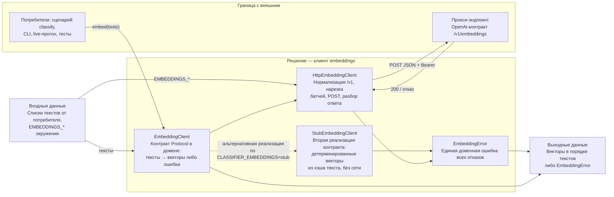

# PS-002: HTTP-клиент OpenAI-совместимого эндпоинта embeddings

**Предмет:** продукт — уровень предмета: что описывается, поведение компонента.

Суть решения: клиент векторизации текстов через OpenAI-совместимый эндпоинт за прокси —
контракт в домене, HTTP-реализация и стаб в инфраструктуре, сборка из окружения, нарезка
батчей и сведение всех отказов в одну доменную ошибку. Статус `Accepted`; источник —
workspace, [`tools/classifier/`](../../tools/classifier/), ревизия `ec95edc`. Известные
копии: фейки тестов `FakeEmbeddingClient` и `SimilarFakeEmbeddingClient` — `tests/fakes.py` —
хэш-векторы с записью вызовов и управляемым отказом; `_stable_vector` фейков разошёлся
с реализацией стаба — 8 измерений против 64.

---

## Навигация

- [Задача](#задача)
- [Архитектура](#архитектура)
- [Бизнес-логика](#бизнес-логика)
- [Правила](#правила)
- [Приёмка](#приёмка)
- [Детали](#детали)
- [Версионирование](#версионирование)

---

## Задача

Что за инструмент: workspace — рабочее пространство систематизации проектов; в нём
`tools/classifier` — CLI-утилита классификации карточек проектов по таксономии SPCF,
сопоставляющая вектор карточки с векторами записей таксономии. Зачем ему эта способность:
классификация построена на векторном сопоставлении — без embeddings-эндпоинта не работает
ни ранжирование, ни метки уверенности; при этом прокси требует суффикса `/v1`, режет
большие запросы и отказывает тремя способами (сеть, статус, тело), а тесты обязаны идти
без сети. Где способность стоит: потребитель один — сценарий `classify`, вызываемый из CLI
и live-прогона; от клиента он получает векторы по контракту `EmbeddingClient`, не зная
о HTTP.

Границы пакета: входит — контракт `EmbeddingClient`/`EmbeddingError`, HTTP-клиент, стаб,
сборка из окружения, выбор реализации в CLI. За границей — сам сценарий `classify`
(ранжирование, пороги, объединённые метки) — отдельное решение; живой прокси и его контракт;
тестовый фейк сценария — приспособление тестов, назван в известных копиях, в пакет не входит.

## Архитектура

Схема описывает модель, а не порядок в коде: в коде контракт и ошибка лежат в домене,
HTTP-клиент — в инфраструктуре, вызов и выбор реализации — в CLI и сценарии; отказ
превращается в `EmbeddingError` внутри клиента в момент разбора ответа, отдельной фазы
проверки нет, поэтому блока верификации на схеме тоже нет.

## Бизнес-логика

Порядок: окружение → нормализация base URL → нарезка батчей → POST → разбор ответа
по индексам → векторы.

### Сборка и нормализация

| Ситуация | Решение |
|---|---|
| Все `EMBEDDINGS_*` заданы | Клиент собирается из окружения (`from_env`) |
| Любая переменная пуста | `EmbeddingError` со списком имён незаданных переменных |
| Base URL без `/v1` | Суффикс дописывается: запрос уходит на `{base}/v1/embeddings` |
| Base URL с хвостовым слэшем | Срезается до проверки суффикса |
| `CLASSIFIER_EMBEDDINGS=stub` в CLI | Подставляется стаб, сеть не трогается |

### Батчи и запросы

| Ситуация | Решение |
|---|---|
| Текстов ≤ 64 | Один запрос |
| Текстов > 64 | Куски по 64 текста, результаты склеиваются в порядке входа |
| Пустой список текстов | Пустой список векторов, запросов нет |
| Прокси медленный | Таймаут 60 с на запрос |

### Разбор ответа

| Ситуация | Решение |
|---|---|
| HTTP 200 с `data` | Векторы выбираются по `index` каждого элемента, порядок — входной |
| Сетевой отказ | `EmbeddingError` «эндпоинт недоступен» с причиной |
| Статус ≠ 200 | `EmbeddingError` с кодом статуса и первыми 200 символами тела |
| Нет `data` или запрошенных индексов | `EmbeddingError` «непригодный ответ эндпоинта» |
| Векторов меньше, чем текстов | `EmbeddingError` через отсутствующий индекс |
| Векторов больше, чем текстов | Лишние молча игнорируются — в источнике не выполняется: контракт обещает ошибку при любом несоответствии числа, проверки на «больше» нет |

### Стаб (тестовый режим)

| Ситуация | Решение |
|---|---|
| Непустой список | Детерминированные векторы из хэша текста: одинаковый текст — одинаковый вектор |
| Пустой список | `EmbeddingError` «пустой список текстов» |

## Правила

- Потребитель зависит от контракта `EmbeddingClient`, а не от HTTP-реализации — защищает сценарий от деталей транспорта и делает подмену фейком тривиальной.
- Все отказы — сети, статуса, тела — сходятся в одну доменную ошибку `EmbeddingError` — потребителю не нужно разбирать три разных исключения.
- Конфигурация только переменными окружения — секреты не попадают в код и аргументы, формат конфигурации один на все прогоны.
- Векторы возвращаются во входном порядке текстов — потребитель не переупорядочивает.
- Батч не превышает 64 текстов — лимит прокси не ломает большой прогон таксономии.
- Ограничение: повторов и экспоненциального отступа нет — отказ сети не ретраится.
- Ограничение: асинхронного варианта нет — потребитель синхронный.
- Ограничение: проверка числа векторов на «больше» отсутствует — лишние векторы игнорируются (зафиксировано в бизнес-логике как невыполняемое в источнике).
- Ограничение: кэширования векторов нет — одинаковые тексты векторизуются заново.

## Приёмка

Сценарии проверяются на клоне workspace с `tools/classifier`, при установленном `uv`.
Живой прокси не нужен: транспорт подменяется `httpx.MockTransport`; CLI-прогоны идут
на `CLASSIFIER_EMBEDDINGS=stub` со снятыми `EMBEDDINGS_*`.

### Основной путь

#### Scenario: Успешный запрос

- **WHEN** переданы тексты и эндпоинт ответил 200 с векторами
- **THEN** векторы возвращены в порядке текстов; запрос ушёл на `{base}/v1/embeddings` с заголовком `Bearer` и телом `{model, input}`

#### Scenario: Суффикс /v1 дописывается

- **WHEN** base URL собран без `/v1`
- **THEN** запрос уходит на `{base}/v1/embeddings`

#### Scenario: Батч режется по лимиту

- **WHEN** передано 70 текстов
- **THEN** отправлено два запроса: 64 и 6 текстов

#### Scenario: Пустой список

- **WHEN** вызван `embed` с пустым списком
- **THEN** возвращён пустой список векторов, запросов не было

### Отказы

#### Scenario: Сетевой отказ

- **WHEN** соединение с эндпоинтом не установлено
- **THEN** `EmbeddingError` с причиной недоступности

#### Scenario: HTTP-отказ

- **WHEN** эндпоинт ответил статусом 500
- **THEN** `EmbeddingError` с кодом статуса в сообщении

#### Scenario: Непригодное тело ответа

- **WHEN** в ответе нет данных запрошенных индексов
- **THEN** `EmbeddingError` «непригодный ответ эндпоинта»

#### Scenario: Не хватает переменных окружения

- **WHEN** `EMBEDDINGS_*` не заданы и запрошена сборка из окружения
- **THEN** `EmbeddingError` перечисляет имена незаданных переменных

#### Scenario: Лишние векторы игнорируются

- **WHEN** эндпоинт вернул больше векторов, чем запрошено текстов
- **THEN** возвращены только запрошенные индексы — в источнике не выполняется: контракт обещает ошибку, проверки на «больше» нет (проверено исполнением)

### Тестовый режим

#### Scenario: Стаб детерминирован

- **WHEN** один и тот же текст векторизован дважды
- **THEN** векторы равны

#### Scenario: Стаб отказывает на пустом списке

- **WHEN** стаб вызван с пустым списком
- **THEN** `EmbeddingError` «пустой список текстов»

#### Scenario: CLI без сети и переменных

- **WHEN** CLI запущен с `CLASSIFIER_EMBEDDINGS=stub` и снятыми `EMBEDDINGS_*`
- **THEN** полный прогон классификации проходит без сети, код возврата 0

## Детали

| Компонент | Где в коде |
|---|---|
| Контракт и доменная ошибка | `EmbeddingClient`, `EmbeddingError` — `src/classifier/domain/embeddings.py` |
| HTTP-клиент | `HttpEmbeddingClient.embed`, `from_env`, `_embed_chunk`; константы `_MAX_BATCH`, `_TIMEOUT` — `src/classifier/infrastructure/http_embeddings.py` |
| Стаб | `StubEmbeddingClient.embed`, `_stable_vector` — `src/classifier/infrastructure/stub_embeddings.py` |
| Выбор реализации в CLI | `_build_client` — `src/classifier/cli/main.py` |
| Живой прогон | `scripts/live_run.py` |
| Тесты клиента и контракта | `tests/test_http_client.py`, `tests/test_embeddings_contract.py`, `tests/test_cli.py` |

---

## Версионирование

| Версия | Дата | Задача | Агент | Модель | Описание изменений |
|--------|------|--------|-------|--------|--------------------|
| 1.0.0 | 2026-11-28 | WRSP-042, OpenSpec change `add-solution-extract`, пилот A | ZCode | GLM-5.3 | Начальное создание: контракт Protocol с доменной ошибкой, HTTP-клиент с нормализацией `/v1`, нарезкой батчей и разбором по индексам, стаб и выбор реализации в CLI, приёмка сценариями |
| 1.1.0 | 2026-11-28 | WRSP-042, пересборка пилота по навыку v1.2.0 | ZCode | GLM-5.3 | Пересобран по шаблону v1.2.0: «Задача» отвечает на три вопроса и называет границы пакета; схема построена по ролям решения — потребитель показан вызывающей стороной, блока верификации нет; известные копии ищутся в источнике и названы (стаб и фейк); правила дополнены причинами и ограничениями. Черновик не принят владельцем, сохранён для аудита со статусом `Proposed` |
| 1.2.0 | 2026-11-28 | WRSP-042, повторный аудит PS-002 | ZCode | GLM-5.3 | Стаб выведен из известных копий — он часть решения и показан на схеме второй реализацией контракта; известные копии — фейки тестов `tests/fakes.py` с отличием 8 измерений против 64 у стаба; входные данные соединены со схемой (тексты → контракт, окружение → клиент); дублирующая строка стаба в «Детали» убрана |
| 1.2.1 | 2026-11-28 | WRSP-042, решение владельца: принять пакет | ZCode | GLM-5.3 | Статус переведён из `Proposed` в `Accepted` |
