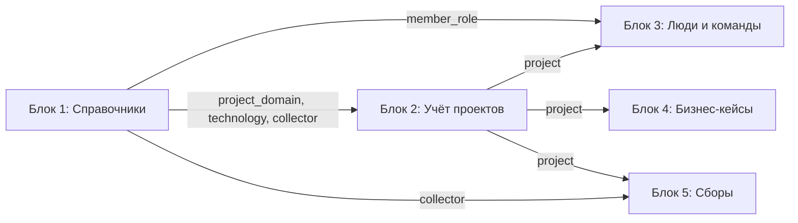
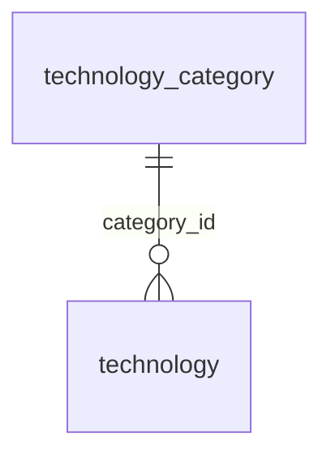
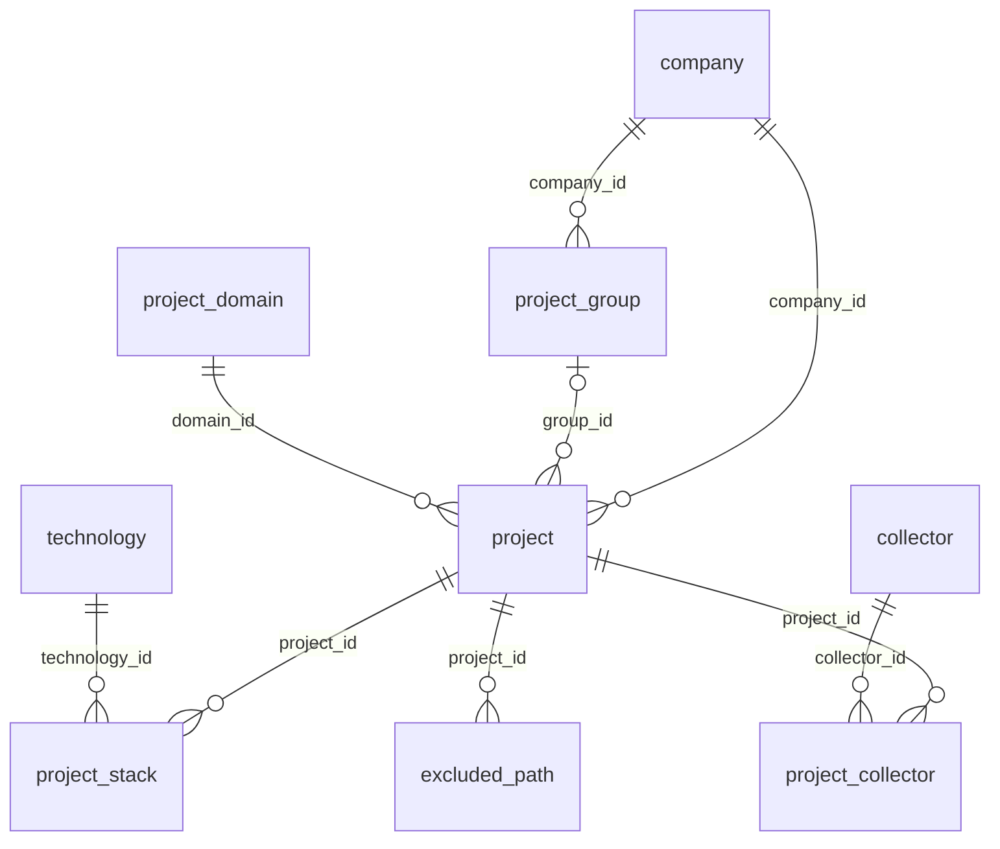
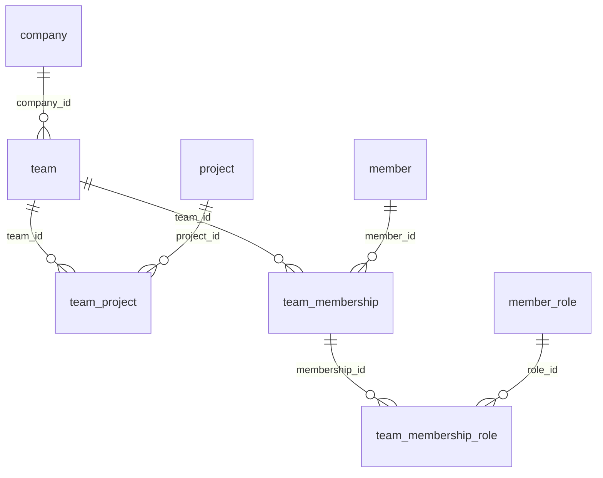
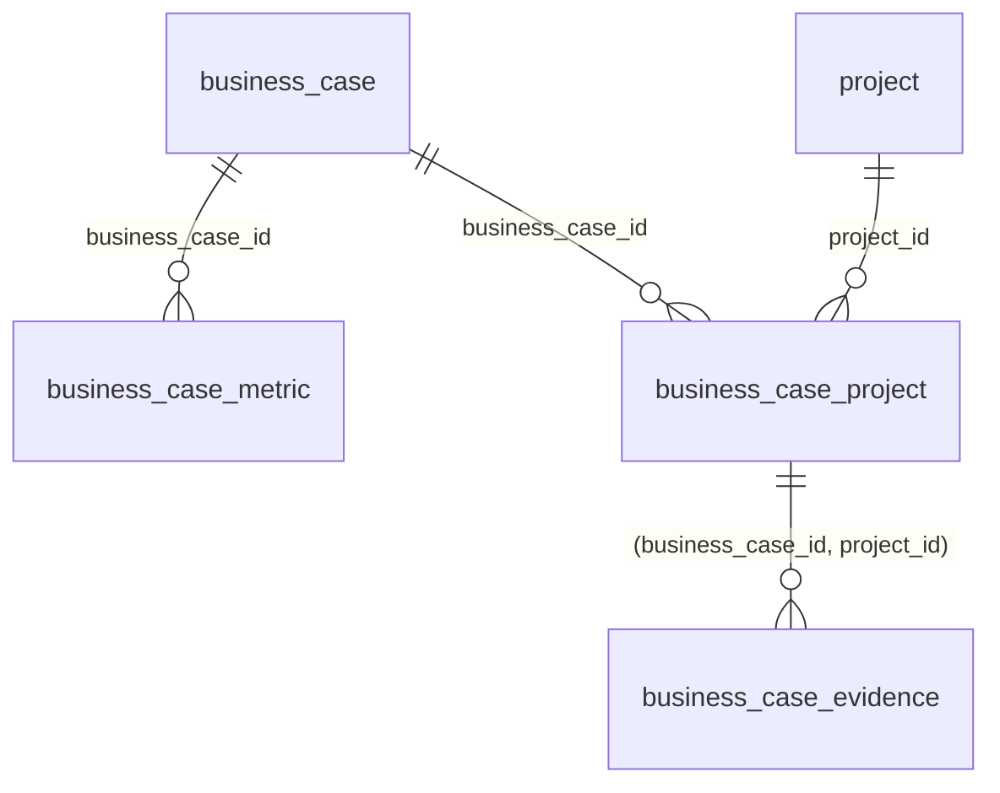
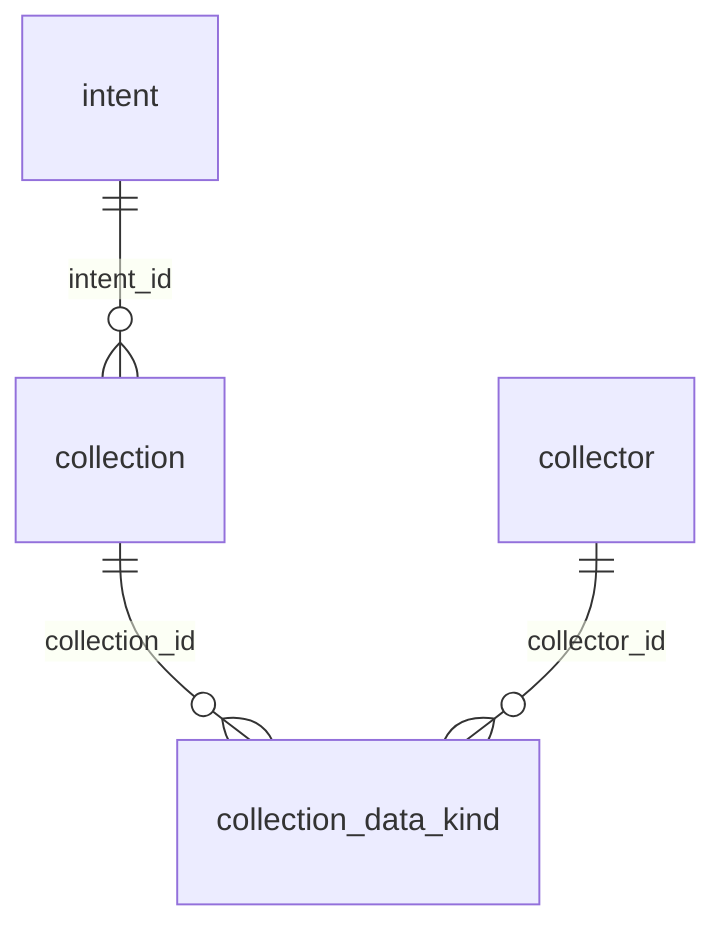

# Блоки модели данных рабочего пространства

Документ описывает пять блоков реляционной модели и общие соглашения, по которым каждый блок
строится через `/forge`. Ссылка на него стоит в промпте каждого блока: агент читает его перед
моделью. Требования — в [docs/requirements.md](../docs/requirements.md), термины — в [docs/glossary.md](../docs/glossary.md).

---

## Навигация

- [Соглашения](#соглашения)
- [Порядок и зависимости](#порядок-и-зависимости)
- [Схема блоков](#схема-блоков)
- [Блок 1. Справочники](#блок-1-справочники)
- [Блок 2. Учёт проектов](#блок-2-учёт-проектов)
- [Блок 3. Люди и команды](#блок-3-люди-и-команды)
- [Блок 4. Бизнес-кейсы](#блок-4-бизнес-кейсы)
- [Блок 5. Сборы](#блок-5-сборы)
- [Ограничения](#ограничения)
- [Версионирование](#версионирование)

---

## Соглашения

- Имена таблиц и колонок — `snake_case`, на английском. Текст значений — на русском.
- У каждой таблицы `id` — `bigint`, `generated: identity` (в forge это `BY DEFAULT`: значение
  выдаёт БД, явное значение при вставке допускается).
- У таблиц-сущностей есть `uuid` (`uuid`, `NOT NULL`, уникальный): неизменяемый идентификатор.
- Машинный короткий код — колонка `code` (`string(64)`, `NOT NULL`, уникальный в своей области).
- Русское название — колонка `name_ru` (`string(255)`, `NOT NULL`).
- Внешний ключ называется по таблице-цели с суффиксом `_id`, например `category_id`.
- Таблицы-связи «многие ко многим» имеют составной первичный ключ из внешних ключей, без `id`.
- Сущности без `uuid` и `code` в блоках ниже не встречаются, кроме связей.

> **Важно:** в ранних записях требований встречается `key`. В модели принято `code`: модель
> блока 1 подтверждена с этим именем.

> **Ограничение:** в блоках 4 и 5 есть проверки значений (`CHECK`) и составной внешний ключ.
> Их поддерживает forge v0.5.0 и новее.

---

## Порядок и зависимости

| Блок | Содержание | Опирается на |
|------|------------|--------------|
| 1 | Справочники | — |
| 2 | Учёт проектов | блок 1 |
| 3 | Люди и команды | блоки 1, 2 |
| 4 | Бизнес-кейсы | блоки 1, 2 |
| 5 | Сборы | блоки 1, 2 |

Каждый блок вносится отдельной операцией `/forge` и принимается до начала следующего: одновременно
открыта может быть только одна операция. Блок, на который ссылается следующий, должен быть принят
в `../db`.

---

## Схема блоков

Общая картина: какой блок на какой опирается и по каким таблицам.

Схемы связей внутри каждого блока — ниже в разделе блока. Связи между блоками показаны
ссылками на таблицы, которые блок получает из предыдущего.

---

## Блок 1. Справочники

Пять справочников без связей с другими блоками, кроме `technology`.

| Таблица | Колонки |
|---------|---------|
| `project_domain` | `id`, `uuid`, `code`, `name_ru` — проектная область |
| `technology_category` | `id`, `uuid`, `code`, `name_ru` — категория технологии |
| `technology` | `id`, `uuid`, `code`, `name_ru`, `category_id` → `technology_category.id` |
| `collector` | `id`, `uuid`, `code`, `name_ru` — коллектор данных |
| `member_role` | `id`, `uuid`, `code`, `name_ru` — роль участника в команде |

Технология относится ровно к одной категории.

---

## Блок 2. Учёт проектов

| Таблица | Колонки и связи |
|---------|-----------------|
| `company` | `id`, `uuid`, `code` (уникальный), `name`, `deregistered_on` (дата, может быть `NULL`) |
| `project_group` | `id`, `uuid`, `company_id` → `company.id`, `code`; уникальность `(company_id, code)` |
| `project` | `id`, `uuid`, `company_id` → `company.id`, `group_id` → `project_group.id` (`NULL`), `domain_id` → `project_domain.id`, `code`, `deregistered_on` (`NULL`); уникальность `(company_id, code)` |
| `project_stack` | `project_id` → `project.id`, `technology_id` → `technology.id`, `version` (`NULL`), `source` (`collector` или `manual`); первичный ключ `(project_id, technology_id)` |
| `project_collector` | `project_id` → `project.id`, `collector_id` → `collector.id`; первичный ключ `(project_id, collector_id)` |
| `excluded_path` | `id`, `uuid`, `project_id` → `project.id`, `path`; уникальность `(project_id, path)` |

Группа проекта необязательна: проект может быть вне группы. Каталог на диске повторяет эту
структуру: `<корень>/<компания>/<группа>/<проект>` либо `<корень>/<компания>/<проект>`.

Связи блока (справочники `project_domain`, `technology`, `collector` — из блока 1):

---

## Блок 3. Люди и команды

| Таблица | Колонки и связи |
|---------|-----------------|
| `member` | `id`, `uuid`, `code` (уникальный), `name` — участник, например «Иван» |
| `team` | `id`, `uuid`, `company_id` → `company.id`, `code`, `name`, `disbanded_on` (`NULL`); уникальность `(company_id, code)` |
| `team_project` | `team_id` → `team.id`, `project_id` → `project.id`; первичный ключ `(team_id, project_id)` |
| `team_membership` | `id`, `uuid`, `team_id` → `team.id`, `member_id` → `member.id`, `joined_on` (`NULL`), `left_on` (`NULL`) |
| `team_membership_role` | `membership_id` → `team_membership.id`, `role_id` → `member_role.id`; первичный ключ `(membership_id, role_id)` |

Участник может состоять в нескольких командах. У членства может быть несколько ролей.
Участники данных не выполняют действий: это таблицы для анализа, кто что делал.

Связи блока (`company` — из блока 2, `project` — из блока 2, `member_role` — из блока 1):

---

## Блок 4. Бизнес-кейсы

| Таблица | Колонки и связи |
|---------|-----------------|
| `business_case` | `id`, `uuid`, `code` (уникальный), `problem`, `task`, `solution`, `outcome_confirmed_at` (`NULL`) |
| `business_case_metric` | `id`, `uuid`, `business_case_id` → `business_case.id`, `name`, `unit` (`NULL`), `target` (число, `NULL`) |
| `business_case_project` | `business_case_id` → `business_case.id`, `project_id` → `project.id`; первичный ключ `(business_case_id, project_id)` |
| `business_case_evidence` | `id`, `uuid`, `business_case_id`, `project_id`, `kind` (`commit` или `branch`), `ref`; составной внешний ключ `(business_case_id, project_id)` → `business_case_project` |

Доказательство относится только к проекту, связанному с кейсом. Подтверждение результата
(`outcome_confirmed_at`) ставит владелец.

Связи блока (`project` — из блока 2):

---

## Блок 5. Сборы

| Таблица | Колонки и связи |
|---------|-----------------|
| `intent` | `id`, `uuid`, `code` (уникальный), `scope_type` (`project`, `group` или `company`), `scope_id` (`bigint`), `created_at` |
| `collection` | `id`, `uuid`, `code` (уникальный), `intent_id` → `intent.id`, `status` (`running`, `done` или `failed`), `started_at`, `finished_at` (`NULL`) |
| `collection_data_kind` | `collection_id` → `collection.id`, `collector_id` → `collector.id`; первичный ключ `(collection_id, collector_id)` |

> **Ограничение:** `intent.scope_id` ссылается на проект, группу или компанию в зависимости от
> `scope_type`, поэтому внешнего ключа у него нет. Проверка согласованности лежит на приложении.

Связи блока (`collector` — из блока 1):

---

## Ограничения

- Модель описывает схему целиком для каждого блока; значения справочников (seed) — отдельная
  операция, после принятия блока.
- Сущности и сборы не добавляют полей вне перечисленных. Новые поля — правкой этого документа и
  новой операцией.
- Удаление таблиц и колонок в накатах требует отдельного согласия владельца.

---

## Версионирование

| Версия | Дата | Задача | Агент | Модель | Описание изменений |
|--------|------|--------|-------|--------|--------------------|
| 1.0.0 | 2026-10-29 | Запрос пользователя: документ контекста блоков модели для промптов `/forge` | Claude Code | Claude Haiku 5.5 | Начальное создание: соглашения именования и колонок, порядок блоков, перечень таблиц и связей блоков 1–5 |
| 1.0.1 | 2026-10-29 | Запрос пользователя: схема всей модели и описание блоков в документе | Claude Code | Claude Haiku 5.5 | Добавлен раздел «Схема блоков» с общей схемой зависимостей блоков и ER-диаграммы связей внутри каждого блока; перечень связей из блоков 1–5 показан по таблицам, цели которых лежат в других блоках |
